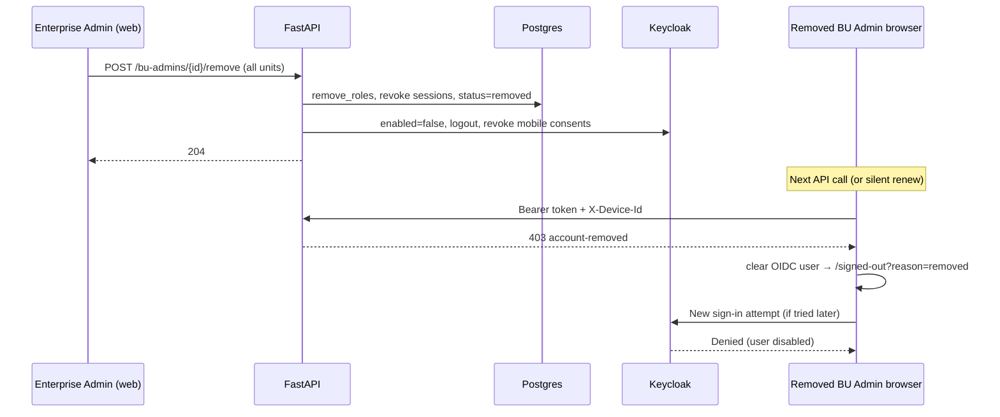

# Plan: Disable Keycloak Login When a BU Admin Is Removed From All Units

| Field | Value |
|---|---|
| Audience | API / Keycloak / web owners |
| Goal | When a BU Admin (or technician) loses **every** unit role, **IdP login must stop immediately** — not only API/app access |
| Specs | `docs/keycloak.md` §6.11 · contracts 1.17 / 1.19 · SPEC-PX-04 REQ-04.09 |
| Status | **Implemented** — Keycloak disable on full removal + web `account-removed` session end |
| Depends on | Existing `_detach` / `mark_removed` / session revoke · `KeycloakAdmin` service account |

---

## 1. Current behaviour (gap)

Today, full removal (no active `user_unit_role` left) already does the **app/API** half:

| Layer | What happens today | Enough? |
|---|---|---|
| Postgres roles | Soft-delete via `removed_at` | Yes for RBAC |
| `app_user.status` | Set to `removed` | Yes for API gate |
| `user_session` | All rows get `revoked_at` | Yes for API tokens tied to device sessions |
| API middleware | Next call → **403** `account-removed` | Yes for in-app access |
| **Keycloak** | User stays `enabled: true`; sessions/refresh tokens remain | **No — login can still succeed** |
| Web client | Auto-redirect only on **401**, not on **403** `account-removed` | Partial — removed user’s tab may keep a JWT until refresh |

Evidence:

- `api/app/services/staff.py` → `_detach` calls `mark_removed` + `revoke_sessions` only.
- `api/app/auth/keycloak_admin.py` has `ensure_user` (always `enabled: True`) and **no** disable / logout / consent-revoke helpers.
- `docs/keycloak.md` §6.11 already specifies the missing Keycloak actions; they were never wired.

**Verdict:** App access is cut; **login is not**. That is what this plan implements.

---

## 2. Target behaviour

### 2.1 Full removal (no units left)

Triggered by:

1. `POST /bu-admins/{user_id}/remove` with every unit ticked (contract 1.17)
2. `PUT /bu-admins/{user_id}/business-units` that drops the last unit(s)
3. `POST /business-units/{bu_id}/technicians/{user_id}/remove` when that was the technician’s last unit (contract 1.19 — same `_detach` path)

**Must happen atomically from the caller’s perspective (same request):**

1. **Existing (keep):** soft-delete roles → revoke DB sessions → `app_user.status = 'removed'`
2. **New — Keycloak (per §6.11):**
   - Set user `enabled = false`
   - `POST /admin/realms/{realm}/users/{kc_id}/logout` (ends SSO sessions)
   - `DELETE /admin/realms/{realm}/users/{kc_id}/consents/pixorex-mobile` (revokes offline refresh; ignore 404 if no consent)
3. **New — Web (removed user’s browser):** on API **403** with problem code `account-removed`, clear local OIDC user and end the Keycloak session (do **not** `signinRedirect` — that would fight a disabled account)

After this, a new OTP / SSO sign-in attempt must fail at Keycloak (disabled user). Existing access tokens still die at the API via `account-removed` / revoked sessions within the documented ≤60s window.

### 2.2 Partial removal (still has other units)

Keep current behaviour:

- Roles / sessions for those units only
- **Do not** disable Keycloak login
- Optional follow-up (out of scope for this change unless cheap): drop realm role `pixorex-web` / `pixorex-mobile` when no role of that kind remains (§6.11 row 2)

### 2.3 Re-invite after removal

`ensure_user` already sends `enabled: True` on invite accept. No separate “enable” API is required for the happy path; re-accept re-enables login.

---

## 3. Design decisions

| # | Decision | Choice | Rationale |
|---|---|---|---|
| D1 | Where to call Keycloak | Inside `_detach` when `active_role_count == 0`, after `mark_removed` + full session revoke | Single choke point for BU Admin + technician full removal |
| D2 | How Keycloak is passed | `KeycloakAdmin` from `request.app.state.keycloak` into staff service methods (same pattern as invite accept) | Avoids hidden globals; testable with existing `FakeKeycloak` |
| D3 | Resolve Keycloak user id | Prefer `app_user.keycloak_user_id`; fall back to Admin API search by `username = app_user_id` | Matches how users are created (`username = app_user_id`) |
| D4 | Failure policy | **Fail closed** when a Keycloak user exists and disable/logout fails (502 / problem); **no-op** if no Keycloak user yet (never activated) | “Login must stop” is a security requirement; silent fail would leave login open |
| D5 | Transaction ordering | Call Keycloak **before** the request transaction commits (invite accept already talks to KC inside the same request). If KC fails, DB rolls back → account stays active, EA can retry | Avoids “removed in DB but still can log in” and “disabled in KC but still active in DB” |
| D6 | Web 403 handling | Dedicated handler: clear user → `/signed-out?reason=removed` (no auto re-login) | Matches remove dialog copy without bouncing a disabled account into Keycloak again |
| D7 | Scope of realm-role pruning on partial remove | **Out of this change** | Login disable is the reported gap; role pruning can be a follow-up |

---

## 4. Implementation steps

### Step A — `KeycloakAdmin.disable_login`

**File:** `api/app/auth/keycloak_admin.py`

Add:

```text
async def disable_login(self, *, app_user_id: str, keycloak_user_id: str | None = None) -> None
```

Behaviour:

1. Resolve user (`GET /users/{id}` or `_find(username=app_user_id)`).
2. If missing → return (nothing to disable).
3. `PUT /users/{kc_id}` with representation that sets `enabled: false` (preserve attributes / email / names from GET so Keycloak does not wipe the profile).
4. `POST /users/{kc_id}/logout`.
5. `DELETE /users/{kc_id}/consents/pixorex-mobile` — treat 404 as success.
6. Raise on unexpected non-2xx for PUT/logout so callers can fail closed.

Do **not** change `_body` / `ensure_user` beyond what already sets `enabled: True` (re-invite path).

### Step B — Repository helper

**File:** `api/app/repositories/users.py`

Add `keycloak_id(conn, user_id) -> str | None` reading `app_user.keycloak_user_id`.

### Step C — Wire into `_detach`

**File:** `api/app/services/staff.py`

- Thread `keycloak: KeycloakAdmin` into `_detach`, `remove_admin`, `set_admin_units`, `remove_technician`.
- When `active_role_count == 0` after role removal:
  1. `mark_removed`
  2. `revoke_sessions` (all)
  3. `await keycloak.disable_login(app_user_id=..., keycloak_user_id=...)`
- Map Keycloak HTTP failures to a clear `ProblemError` (e.g. 502 / `keycloak-unavailable`) so the EA sees that removal did not complete.

### Step D — Routers

**File:** `api/app/routers/staff.py`

Pass `request.app.state.keycloak` into `remove_admin`, `set_admin_units`, and `remove_technician`.

### Step E — Integration / unit test fakes

| File | Change |
|---|---|
| `api/tests/integration/helpers.py` | `FakeKeycloak.disable_login` records calls (`disabled: list[str]`) |
| `api/tests/integration/test_staff.py` | Assert `disable_login` was called for full BU Admin + full technician removal; **not** called on partial remove |
| `api/tests/unit/test_keycloak_admin.py` | Extend `FakeKeycloak` mock transport for GET-by-id, PUT `enabled=false`, POST logout, DELETE consents; unit-test `disable_login` |

### Step F — Web: treat `account-removed` as session end

| File | Change |
|---|---|
| `web/src/auth/session.ts` | Add `handleAccountRemoved()` → `removeUser` + navigate to `/signed-out?reason=removed` |
| `web/src/api/client.ts` | On **403**, if problem type ends with `account-removed`, call that handler (clone body) |
| `web/src/auth/AuthPages.tsx` | `SignedOutPage`: when `reason=removed`, show access-removed message; do not auto `signIn` |
| `web/src/auth/auth.test.tsx` | Cover the new path; ensure we do **not** `signinRedirect` |

---

## 5. Sequence (full BU Admin remove)



---

## 6. Test plan

- [x] Unit: `disable_login` sets `enabled=false`, calls logout, deletes mobile consent; no-op when user missing; 404 consent ignored (`uv run pytest tests/unit/test_keycloak_admin.py`)
- [x] Integration assertions added: full BU Admin / technician remove → `FakeKeycloak.disabled`; partial drop → not disabled (needs `PIXOREX_TEST_ADMIN_URL` to run)
- [x] Web: 403 `account-removed` clears user → `/signed-out?reason=removed` (no sign-in redirect); vitest green
- [ ] Manual (local): remove a signed-in BU Admin from all units → their next `/me` fails and Keycloak login with same email is refused; re-invite + accept → login works again

Note: `PUT .../business-units` cannot drop the last unit (validation forces Remove), so full disable is covered by `POST .../remove` and last-technician remove only.

---

## 7. Out of scope

- Partial-removal realm-role pruning (`pixorex-web` / `pixorex-mobile`)
- Changing OTP / brute-force / theme behaviour in Keycloak realm JSON
- Mobile Flutter client UX beyond IdP disable + consent revoke (API 403 already applies)
- New DB columns or status values (reuse `removed` + Keycloak `enabled`)

---

## 8. Risks and mitigations

| Risk | Mitigation |
|---|---|
| Keycloak down blocks EA removal | Fail closed with clear error; EA retries; API access already blocked only after success |
| User never had `keycloak_user_id` | Lookup by username; no-op if absent (cannot log in anyway) |
| PUT wipes attributes | Always GET then merge `enabled: false` into current representation |
| Web loops on 403 | Use logout / `/signed-out`, never `signinRedirect`, for `account-removed` |

---

## 9. Done when

1. Full removal disables Keycloak login in the same request that marks the account removed.
2. Partial removal does not disable login.
3. Re-invite accept re-enables via existing `ensure_user`.
4. Removed user’s web session ends on `account-removed` without a re-login loop.
5. Unit + integration tests above are green (or skipped only when `PIXOREX_TEST_ADMIN_URL` is unset, same as today).
