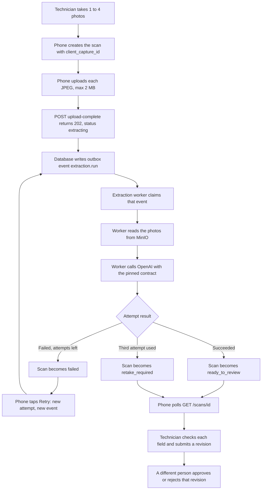
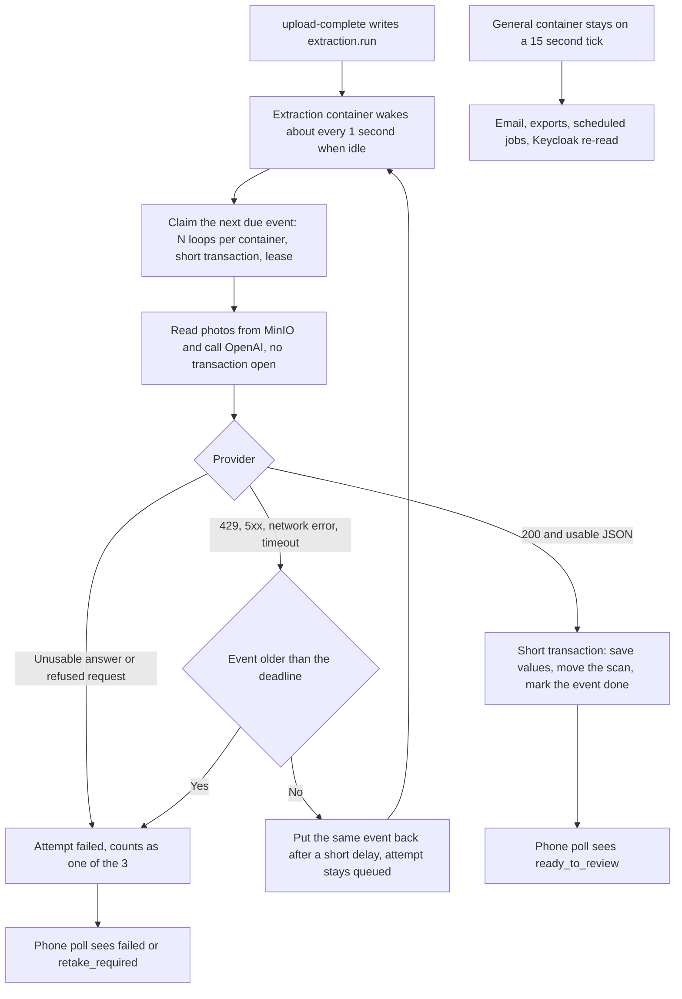

# Scan extraction: current flow, flaws, and proposed change

Branch reviewed: `integration/combined-with-mobile` at `abb94b7` (3 Nov 2026).

Status: proposal. Steps 1, 2, 4, and 5 are done on branch `PX-03-extraction-flow`: steps 1, 2, and 4 in `api/app/workers/`, `docker-compose.yml`, and `.env.example`, step 5 in `docs/mobile-api.md`. Step 3 is not built: it waits for a decision (see "Decision needed"). The "Existing flow" and "Flaws" sections describe `abb94b7`, before these steps.

This note covers the path from a technician’s photos to an OpenAI extraction. It does not propose a new service, a second queue, new tables or columns, or a change to the scan and review model.

## Existing flow

Two worker containers share one outbox table. Each claims only its own event types with `FOR UPDATE SKIP LOCKED`.

| Container | Role | What it runs | Wake interval |
|---|---|---|---|
| `worker` | `general` | Email, exports, escalation, waiting and batch alerts, invite expiry, idempotency-key cleanup, Keycloak re-read | 15 seconds for the outbox, 60 seconds for scheduled jobs, 5 minutes for the Keycloak re-read |
| `extraction-worker` | `extraction` | `extraction.run` only | 15 seconds, the same setting as email |

Compose starts one extraction container. More copies are `--scale extraction-worker=N`. Each copy runs one OpenAI call at a time.



Uploads do not call OpenAI. Each photo is stored when it arrives. `upload-complete` checks that photos 1 to n are all there, queues attempt 1, writes the outbox row in the same transaction, and returns. The phone learns the result by polling `GET /scans/{id}`. There is no push when extraction finishes.

Offline is the same path. The phone holds the scan locally (`queued_on_phone` exists only on the phone). When the network returns it sends the same create, photo, and `upload-complete` calls. Those rows join the one outbox in arrival order. The mobile app has only sign-in screens so far, so everything on the phone side is the contract in `docs/mobile-api.md`, not shipped code.

### One event, start to finish

The outbox runner (`run_due` in `api/app/workers/outbox.py`) opens one database transaction per event, and everything below happens inside it:

1. Claim the oldest due event.
2. Lock the attempt and its scan (`FOR UPDATE`).
3. Read the photos from MinIO, one after another.
4. Call OpenAI with the pinned contract (timeout 60 seconds).
5. Write one `ai_field_value` per field, finish the attempt, move the scan, mark the event done.
6. Commit.

An error on the retry list (OS and network errors, `LookupError`, boto errors, SMTP errors) undoes the writes of the handler, counts one try on the event, and backs it off 1, 2, 4, 8, and 16 minutes. The sixth failure marks the event `failed`, and for extraction it fails the attempt. Any other error rolls back the whole transaction and leaves the event exactly as it was.

A provider failure is handled inside the extraction handler, and the outbox event is then marked done:

| Provider outcome | Scan attempt | Outbox event |
|---|---|---|
| HTTP 200 and usable JSON | `succeeded` | done |
| HTTP 200 but no usable JSON | `failed` | done |
| HTTP 429, any other non-200, or a network error | `failed` | done |
| Timeout (60 seconds) | `timed_out` | done |
| OpenAI key not set, or MinIO not set or unreachable | unchanged | stays pending and retries, up to 6 times |

`failed` and `timed_out` count toward the three attempts on the scan. The third one sets `retake_required`. A finished attempt always counts: the API counts attempt rows, and the table only allows attempt numbers 1 to 3.

The API’s own limit of 100 requests a minute per tenant is not built. Scans are counted toward the monthly quota and are not refused. ARCHITECTURE.md section 7 also expects per-tenant rate limits in the AI proxy. Those are not built either.

## Flaws

**1. One bad event stops the extraction queue.** Only errors on the retry list are counted and backed off. Any other error rolls the transaction back, so the event keeps its place at the front of the line and is claimed again on the next tick. The events behind it never run, and its scan stays `extracting`. Running the real `run_due` against a fake pool confirmed this: over five ticks the bad event ran five times and the healthy event behind it never ran. No likely trigger exists in the current schema (`ai_field_value.value` is plain text and confidences are clamped), so the risk is latent. A failure that repeats after the OpenAI call would pay for a new call on every pass, and a shorter tick makes the loop faster.

**2. The transaction stays open during the OpenAI call.** The claim, the MinIO reads, and the call (up to 60 seconds) share one transaction, and the attempt and scan rows stay locked until it ends. Four effects follow from how Postgres locks rows:

- `discard` and a repeated `upload-complete` lock the same scan row, so they wait for the call. The phone client has a default timeout of 20 seconds.
- A repeated `upload-complete` gets 202 only while its event still waits in the queue. Once the worker has the row, the repeat waits and then gets 409 `invalid-state`, although `docs/mobile-api.md` calls it safe to repeat. Faster extraction narrows the window, so offline reconnects will meet the 409 more often.
- Every call in flight holds a pooled connection (the worker pool allows 2). The only way to run more calls is more containers.
- The `running` attempt status in the contract is never written, so nothing can tell "waiting" from "being read".

The first effect, and the wait in the second, were reproduced against a real PostgreSQL on `abb94b7`: with an AI call held open, a `discard` and a repeated `upload-complete` had each not answered after 3 seconds. Both tests fail there and pass after step 4. The 409 that follows the wait, the pool size, and the unused `running` status were read in code only.

**3. The extraction worker waits on the email clock.** `worker_tick_s` defaults to 15 seconds because that is how often mail is sent. When the worker is idle, a scan can sit in the outbox for that long before OpenAI is called. PRD FR-4.9 sets the target at under 15 seconds at p95 for background extraction and does not say where the clock starts. The technician feels the time from `upload-complete`, so the wait counts. Shortening the tick does not start more calls. It only makes the single worker notice the next row sooner.

**4. Parallel uploads become a single file of OpenAI calls, and containers are the only knob.** The API accepts many uploads at once. One extraction container then calls OpenAI one scan at a time, and every other scan waits. A person who just submitted waits behind whatever is already pending. With one container and a call of several seconds, a shift of phones uploading together produces a line measured in minutes. The only way to add parallelism today is another container, which is another Python process for each call in flight, scaled by hand against the OpenAI account limits. Nothing tracks requests per minute or tokens per minute. Ten containers send ten calls together.

**5. Problems that are not about the photos spend an attempt.** A 429, a 5xx, a network error, or a timeout marks the attempt `failed` or `timed_out` and closes the outbox event. The photos were readable. The scan still loses one of its three tries, the technician has to tap Retry by hand, and the third such failure demands a retake. Two things make this harder to fix than it looks:

- The outbox retry starts at one minute (1, 2, 4, 8, 16). That is too slow for someone waiting on the screen, so a short retry needs new code.
- A 429 is not always a rate limit. OpenAI also uses it when the account is out of credit (`insufficient_quota`). A retry rule with no limit would spin on that, and on any scan that always times out, leaving the scan in `extracting` while the phone keeps polling.

These cases are the open decisions O-20 and P-12.

**6. Online and offline share that one file.** A phone that reconnects uses the same endpoints as a phone that was online the whole time. There is no delay between devices and no priority for someone standing on the results screen. A backlog flush and a live capture are ordered only by who reached `upload-complete` first. The mobile app has no capture code yet, so nothing paces a backlog flush.

**7. Nothing measures the 15 second target.** No log or metric separates time spent waiting from time spent calling. `extraction_attempt.created_at` to `updated_at` is a free end-to-end measure (query at the end of this note), but there is no per-step timing.

**8. Small things in the same files.** Each is a few lines:

- `extraction.run` opens a new HTTP client for every call, so each call pays a fresh TLS handshake. The shared client in the runner is not used by the extraction role. Reuse one client.
- Photos are read from MinIO one after another. Read them in parallel.
- On SIGTERM the runner finishes up to 50 events before it checks the stop flag, and Compose sets no `stop_grace_period`. A deploy kills the worker mid-call after Docker’s default 10 seconds, and the call is paid for twice. Check the flag between events and set the grace period a little above `ai_timeout_s`.
- The 60 second timeout is the httpx timeout for each phase, not a total deadline. Put a total deadline around the call.

Done with steps 2 and 4: the total deadline around the call, the stop flag check between events, and the 90 second grace period. Not done: the shared HTTP client and the parallel photo reads.

## Proposal

Keep this flow. The extraction container is already separate from email and scheduled jobs, and that split is the right boundary.

Five steps. Each ships on its own and needs no new table or column. Only step 3 needs a decision. Do step 1 first: it is small, and a shorter tick makes the unhandled-error loop in flaw 1 run faster.

| Step | Needs a decision | State | Mainly touches |
|---|---|---|---|
| 1. Harden, then wake faster | No | Done | `workers/outbox.py`, `workers/extraction.py`, `docker-compose.yml` |
| 2. Set concurrency, not container count | No | Done | `workers/runner.py`, `workers/settings.py`, `docker-compose.yml` |
| 3. Retry provider trouble instead of failing the scan | Yes (O-20, P-12) | Waits for the decision | `services/ai_proxy.py`, `workers/extraction.py`, `workers/outbox.py`, the contract |
| 4. Do not hold the transaction during the call | No | Done | `workers/outbox.py`, `workers/extraction.py`, `workers/runner.py` |
| 5. Fix the phone contract now | No | Done | `docs/mobile-api.md` |

Steps 3 and 4 may each need two tasks to stay inside the five-file, 200-line limit. Task IDs come from `STATE.md` when the steps are scheduled. The small items under flaw 8 ride along with whichever step touches the same file.

### Step 1: Harden, then wake faster

- In `run_due`, treat any exception from a handler like a retry-list error: count it, back it off, and give up after six tries. `give_up` then fails the attempt, so the technician sees `failed` instead of a scan stuck in `extracting`. Log the traceback.
- Set `PIXOREX_WORKER_TICK_S=1` on `extraction-worker` only. Leave `worker` at 15 seconds.
- Log `queue_wait_ms` and `provider_ms` for each extraction. No photo content and no field values.
- Also part of step 1: the clean-up that runs when an event is failed for good (`give_up`) now runs in a savepoint. Without that, a clean-up that always fails would roll the event back and bring it back on every tick, with a new provider call each time.
- First test: GIVEN a handler that raises `ValueError` for the oldest event WHEN `run_due` runs THEN that event is backed off with one try counted, and the event behind it is handled in the same run.

### Step 2: Set concurrency, not container count

- New setting `PIXOREX_EXTRACTION_CONCURRENCY` (default 4). The extraction container runs that many claim loops in one process. The connection pool grows to match (`max_size` is concurrency plus 1).
- Calls in flight equal containers times concurrency. Keep that at or below what the OpenAI account accepts at the same time. A second container is for failover, not for speed.
- Sizing: calls in flight is about scans per second times seconds per call. With an assumed 8 seconds per call, 30 scans in one minute need about 4 in flight.
- First test: GIVEN 10 due events and concurrency 3 WHEN the loops run THEN no more than 3 provider calls are in flight and no event runs twice.

Done: `extraction_concurrency` in `workers/settings.py` (1 to 32, default 4). `run_claim_loops` in `workers/runner.py` starts that many `claim_loop`s in the extraction container, and the pool has concurrency plus 1 connections. Compose passes `PIXOREX_EXTRACTION_CONCURRENCY` (default 4) and now calls a second copy a failover. The other roles keep one loop. Tests: `test_the_extraction_container_makes_several_ai_calls_at_once` (10 scans, concurrency 3: never more than 3 calls open, each scan extracted once) and unit tests for the setting and the pool size.

### Step 3: Retry provider trouble instead of failing the scan

Needs the decision below. "Defer" means: leave the attempt `queued` and the scan `extracting`, and put the same event back with a later `next_run_at`.

- Delay: the `Retry-After` header when OpenAI sends one, otherwise 2 seconds growing to at most 30, with jitter. Loops in one container share a cool-down, so one 429 does not send four loops back at once.
- A deferral does not count as an outbox try. The deadline is its only limit. Once the event is older than the deadline (proposed default 3 minutes, measured from `outbox_event.created_at`), the attempt ends `failed` or `timed_out` and counts, as today. The deadline also limits how many paid-for timeouts one scan can cause, to about two or three.
- The outbox backoff starts at one minute, so extraction events need their own delay.
- A new exception for "provider busy" keeps `AiUnavailableError` meaning "the answer is unusable".
- First tests: GIVEN a 429 with `Retry-After: 2` WHEN the worker runs THEN the attempt is still `queued`, the event is due again in about 2 seconds, and the scan has the same number of attempts. GIVEN an event older than the deadline WHEN the provider is still busy THEN the attempt ends `failed` and counts. The existing test `test_a_failed_extraction_allows_retries_then_a_retake` changes: it uses a timeout for its second and third attempts, and a timeout now defers, so those steps need an unusable answer instead.

### Step 4: Do not hold the transaction during the call

- Claim with a lease. In a short transaction, set `next_run_at` to now plus a little more than `ai_timeout_s` (for example 90 seconds) and commit. The existing column does the job, and an event whose worker died becomes due again when the lease ends.
- Read what the call needs, then give the connection back. Read the photos and call OpenAI with no transaction open.
- Write the result in a second short transaction: lock the attempt and scan, check the attempt is still `queued` and the scan is still `draft` and `extracting`, then save the values and mark the event done. If the scan was discarded during the call, nothing is written. If the lease ran out and a second worker also called OpenAI, only the first write lands.
- Effects: `discard` and a repeated `upload-complete` no longer wait on the worker, a connection is held for milliseconds instead of the whole call, and the pool can stay small.
- This applies to extraction events only. Email and export handlers keep running inside the claim transaction, which their at-least-once handling relies on.
- Optional: write `running` when the lease is taken, and let the final write accept `queued` or `running`. The contract already declares the status.
- First test: GIVEN a call in progress WHEN the technician discards the scan THEN the discard returns at once and the finished call writes nothing.

Done, as planned except that `running` is not written:

- `outbox.py`: an event type listed in `LEASED` (only `extraction.run`) is claimed in a short transaction that also sets `next_run_at` to now plus `ai_timeout_s` plus 30 seconds. `extraction.prepare` reads the attempt, the photo keys, the fields, and the types in that transaction. `extraction.call` reads the photos and asks OpenAI with no connection held, inside one deadline of `ai_timeout_s` plus 10 seconds. `extraction.finish` runs in a second short transaction: it locks the attempt again and saves the outcome only if the attempt is still `queued` and the scan is still `draft` and `extracting`.
- A failed try is now one SQL update that adds 1 to `attempts` and only touches events that are still pending, so a slow worker cannot bring back an event that another worker finished.
- `run_due` takes a `stop` event, so a worker told to stop takes no more events, and Compose gives the container 90 seconds (`stop_grace_period`) to finish the calls in flight. A worker that is killed anyway leaves a leased event that comes due when the lease ends.
- Tests: a discard and a repeated `upload-complete` during a call answer at once; a worker that dies leaves a leased event with no failure counted; when a lease runs out and a second worker extracts the scan, the first call result is not saved again; a worker told to stop takes no more events.

### Step 5: Fix the phone contract now

The mobile app has no capture code yet, so this costs nothing today. In `docs/mobile-api.md`:

- Poll until `processing_status` is `ready_to_review`, `failed`, or `retake_required`. Section 5 left out `retake_required`. Suggested pace: every 2 seconds for the first 20 seconds, then every 5 seconds. After about 30 seconds show "taking longer than usual". With step 3 the scan can stay `extracting` while the worker retries provider trouble.
- A 409 `invalid-state` on a repeated `upload-complete` means the upload is already confirmed. Read the scan and carry on.
- Offline flush: oldest first, at most 2 scans being sent at a time.

Any change to API behaviour goes into `contracts/*.yaml` and `docs/api-contracts.md` in the same change.

### Target flow



Online and offline stay on this path. A live user waits only for the scans ahead of them, in a line that moves several calls at a time. A provider rate limit or outage no longer turns into a retake unless it lasts past the deadline.

## Decision needed (O-20 and P-12)

Steps 1, 2, 4, and 5 touch nothing that is OPEN. Step 3 settles O-20 (does a proxy refusal use one of the three attempts?) and P-12 (what happens on an ambiguous provider timeout?). ARCHITECTURE.md section 7 lists both as OPEN, `contracts/slice-s3-capture-extraction.yaml` marks `retryExtraction` with `x-decision-pending`, and `STATE.md` records no decision. The attempt budget is also A1 (CONSTITUTION.md, BC-03), so the change needs human review. CLAUDE.md says to stop and ask before building an OPEN item, so step 3 waits.

The three refusals named in O-20 (injection 400, quota 402, rate limit 429) are Pixorex proxy responses that are not built yet. The table below covers what OpenAI itself returns, which raises the same question.

Proposed wording for the Manager and TA (not decided):

> Failures that say nothing about the photos (provider rate limit or outage, network error, timeout, or a problem with our own key or billing) do not use an attempt. The worker retries for up to 3 minutes. If the trouble lasts longer, the attempt ends as failed or timed out and counts, as it does today. Failures about the photos or the request (an injection refusal, an unusable answer) use an attempt. When the proxy refusals named in O-20 are built, quota (402) and per-tenant rate limit (429) follow the first rule, and injection (400) follows the second.

| Outcome | Kind | What the worker does |
|---|---|---|
| 200 and usable JSON | Answered | Saves the values. Attempt `succeeded`. |
| 200 but no usable JSON, or a 4xx that retrying cannot fix (400, 413, 422) | About the photos or the request | Attempt `failed`. Counts. |
| 429 rate limit, 5xx, network error | Provider busy | Defers. Attempt stays `queued`. |
| Timeout (60 seconds) | Provider busy (the P-12 case) | Defers, same rule. |
| 401, 403, 429 with `insufficient_quota` | Our key or billing | Defers on the slower end of the delay range, and logs an error with a fixed reason code so ops can alert. |
| Still failing after the deadline (proposed 3 minutes) | Not recovering | Attempt `failed` or `timed_out`. Counts. |
| OpenAI key not set, or MinIO not set or unreachable | Our setup | Unchanged. Stays pending and the outbox retries it. |

A finished attempt always counts, so "does not use an attempt" can only hold while the attempt is still `queued`. The deadline is what ends the wait.

When it is decided: record it in `STATE.md` under Decisions, remove the `x-decision-pending` mark on `retryExtraction`, and update the O-20 row in `docs/api-contracts.md` and the status notes in `docs/mobile-api.md` in the same change.

## Not proposing now

- **LISTEN/NOTIFY.** A one-second poll on the partial index `ix_outbox_event_due` is cheap, and a 15 second target does not need millisecond wake-ups.
- **Priority lanes or per-tenant fair share.** ARCHITECTURE.md section 7 puts per-tenant limits in the proxy. Revisit when measurements show a problem or a second tenant arrives. Pacing on the phone (step 5) covers the offline flush for now.
- **Another queue, a new service, or long-poll and SSE for results.** Nothing in this note needs them.
- **A JSON schema for OpenAI answers.** Answers are parsed from free text with a regex, and unusable answers burn attempts. Asking OpenAI for schema-checked JSON would remove most of them. It changes the prompt and the proxy, which are A1 (human review), so it is a separate decision.

## How to tell it worked

Baseline today, from `upload-complete` to the result, as the technician feels it:

```sql
SELECT count(*) AS scans,
       percentile_cont(0.5)  WITHIN GROUP (ORDER BY extract(epoch FROM updated_at - created_at)) AS p50_s,
       percentile_cont(0.95) WITHIN GROUP (ORDER BY extract(epoch FROM updated_at - created_at)) AS p95_s
FROM extraction_attempt
WHERE status = 'succeeded' AND created_at > now() - interval '7 days';
```

After step 1, the `queue_wait_ms` and `provider_ms` log fields split the wait from the call. The target is p95 under 15 seconds (PRD FR-4.9) at the busiest expected moment, for example a shift of phones uploading together.

What this note rests on. Read in code: every statement above. Run: the whole API test suite against a real PostgreSQL 18 on this branch (288 tests). That includes the lock effects in flaw 2, whose new tests fail on `abb94b7`, and the one-bad-event case in flaw 1, which was also run earlier against a fake pool. Not run: real timings, a live OpenAI call, or the Compose stack (its settings were only checked with `docker compose config`). Any seconds-per-call figure is an assumption until the query above has been run on real data.
