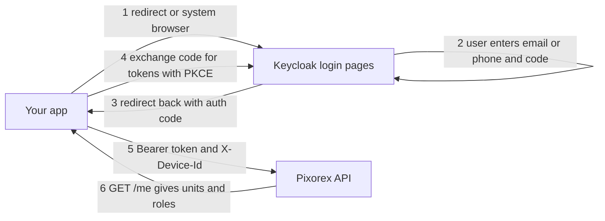
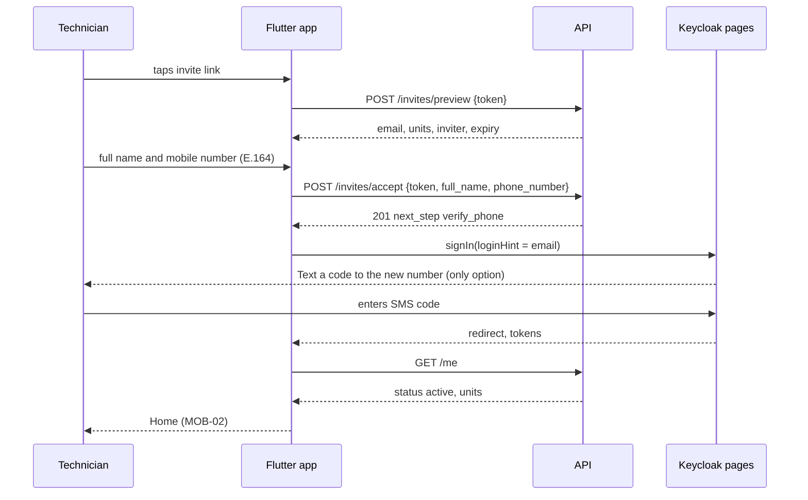

# Keycloak Integration Guide for Web and Mobile Developers

| Field | Value |
|---|---|
| Audience | Web developer (React + TS, `web/`) and mobile developer (Flutter, `mobile/`) |
| Keycloak owner | Keycloak / identity owner (realm, login theme, OTP plugin, event listener) |
| Design reference | `docs/keycloak.md` (why things work this way). This guide is the "how do I build my part" version |
| Specs | SPEC-PX-01 (REQ-01.11, REQ-01.13), contracts 1.1–1.3, 1.6–1.7 in `docs/api-contracts.md` |
| Grade | Client token handling is **A0** (CONSTITUTION §5): write it by hand, architect co-signs the PR. Agents may write tests only |

---

## 1. The 2-minute mental model

1. **Your app never shows a sign-in form, never sees a code, never stores a password.** You open Keycloak (a redirect on web, the system browser on mobile). Keycloak asks for the email or phone number, sends the code, checks it, handles lockout, and sends the user back to your app with an authorization code.
2. Your app exchanges that code for **tokens** (OIDC Authorization Code + PKCE, done by the library).
3. You send the **access token** on every API call, plus `X-Device-Id`.
4. You call **`GET /me`** to learn who the user is, their units, roles and active unit. **Never read roles from the token.** The token only says who the user is and which tenant they belong to.
5. When the access token expires (every 5 minutes), the library **refreshes** it silently.
6. Invitations are **API calls** (`/invites/preview`, `/invites/accept`), not Keycloak. After accept, you start a normal Keycloak sign-in. That first sign-in **activates** the account.



---

## 2. Who builds what

| Piece | Keycloak owner | Web dev | Mobile dev |
|---|---|---|---|
| Realm, clients, redirect URIs, token lifetimes | ✅ | tells owner the URLs | tells owner the scheme or links |
| Login pages: identifier, SMS/email choice, code entry, resend timer, expired/invalid/locked messages, "use the mobile app" denial | ✅ theme (PX-01-T10 with web dev for styling) | styling help | — |
| OTP generation, SMS/email sending, lockout, throttling | ✅ | — | — |
| OIDC sign-in, callback, token storage, refresh, sign-out | — | ✅ PX-01-T12 | ✅ PX-01-T15 |
| `X-Device-Id`, Bearer header, 401/403 handling in the API client | — | ✅ PX-01-T11 | ✅ PX-01-T14 |
| Invite screens (preview, accept, name and phone entry) | — | ✅ `/invite` (admins) | ✅ invite deep link (technicians) |
| Home and unit switch from `/me` and `/me/active-unit` | — | ✅ PX-01-T13 | ✅ PX-01-T16 |
| Phone change | ✅ Keycloak action `pixorex-update-phone` | — | ✅ starts it (blocked until O-12 is decided) |
| App Links / Universal Links files on the app domain | — | hosts them | provides app ids, cert fingerprints, team id |

**Which screens are native and which are Keycloak pages.** In MOB-01 and the admin sign-in screens, everything from "enter your email or number" to "code accepted" is a Keycloak page. Your native or SPA screens are the welcome screen with the **Sign in** button, the invite screens, and the screens after sign-in.

---

## 3. Configuration values

Ask the Keycloak owner for anything marked TBD. Never hard-code these; read them from build or env config.

| Value | Local | India E2E / US VPS / Prod |
|---|---|---|
| Issuer (authority) | `http://localhost:8080/realms/pixorex` (web) · `http://<laptop-LAN-IP>:8080/realms/pixorex` (mobile on a phone, see §7) | `https://auth.<domain>/realms/pixorex` (TBD) |
| Discovery document | `<issuer>/.well-known/openid-configuration` | same |
| Web client id | `pixorex-web` | `pixorex-web` |
| Mobile client id | `pixorex-mobile` | `pixorex-mobile` |
| Web redirect URI | `http://localhost:5173/auth/callback` | `https://app.<domain>/auth/callback` |
| Web silent-renew URI | `http://localhost:5173/auth/silent` | `https://app.<domain>/auth/silent` |
| Web post-logout URI | `http://localhost:5173/signed-out` | `https://app.<domain>/signed-out` |
| Mobile redirect URI | `com.pixorex.mobile:/oauth2redirect` | same (or a claimed HTTPS link if we switch) |
| Mobile post-logout URI | `com.pixorex.mobile:/logout` | same |
| Scopes (web) | `openid profile email` | same |
| Scopes (mobile) | `openid profile email offline_access` | same |
| API base URL | `http://localhost:8000/api/v1` | `https://api.<domain>/api/v1` (TBD) |
| Codes during local testing | Mailpit inbox `http://localhost:8025` (email and SMS both land here) | real email and SMS |

There is **no client secret** for web or mobile. Both are public clients protected by PKCE. If anyone asks you to put a secret in the app, say no.

---

## 4. Rules for both apps

### 4.1 Tokens

| Token | What it is | What you do with it |
|---|---|---|
| Access token (JWT, 5 min) | Proof of identity for the API | Send as `Authorization: Bearer <token>`. Don't parse it for decisions |
| Refresh token | Gets new access tokens | Web: memory only. Mobile: secure storage. Never log it |
| ID token | Who signed in | Needed for logout (`id_token_hint`). You may read `email` for display |

Claims you may read: `app_user_id` (to partition local caches, for example the mobile offline queue), `tenant_id`, `email`. **Do not** derive roles, units or permissions from the token. Use `GET /me`.

### 4.2 Headers on every API call

```text
Authorization: Bearer <access_token>
X-Device-Id: <uuid generated once>
```

- Web: random UUID stored in `localStorage` under `pixorex.device_id`, created on first load.
- Mobile: random UUID created on first launch, stored in secure storage, kept across sign-outs (one per install).
- `/invites/preview`, `/invites/accept`, `/health` and `/ready` need **no** token.

### 4.3 Handling API responses

| Response | Meaning | What the app does |
|---|---|---|
| 401 | Token expired or invalid, session revoked, user removed | Refresh once and retry once. Still 401 → clear tokens locally, go to the sign-in screen with "Your session ended, please sign in again" |
| 403 `forbidden` | No role in that unit (for example removed from it) | Show "You no longer have access to this unit", re-fetch `/me`, switch to another unit or show the empty state |
| 409 `invite-expired` / `invite-used` / `invite-cancelled` | Invite link no longer valid | Show the matching message: "Ask your admin to send a new invite" / "Already used — sign in instead" / "This invite was cancelled" |
| 409 `phone-in-use` | Number belongs to someone else (invite accept) | Inline error on the phone field |
| 5xx / network | — | Retry with backoff. Mobile keeps queued scans and never discards them |

Never retry an API call in a loop with a refresh in between. **One refresh, one retry**, then give up.

### 4.4 After sign-in, always

1. Call `GET /me` with `X-Device-Id`.
2. If it returns 200, open Home in `active_bu_id` (or `last_bu_id`).
3. Unit switch = `PUT /me/active-unit {bu_id}`. **Never** start a new sign-in to switch units.

### 4.5 Things you must not do

- No embedded WebView or iframe for the login page (except the web silent-renew iframe the library manages).
- No `grant_type=password` / "direct access grants". It is disabled and will fail.
- No tokens in URLs, logs, crash reports or analytics.
- No invite token in API request URLs. It goes in the request **body**.
- Don't build your own "wrong code" or "locked" screens. Keycloak shows them.

---

## 5. Web developer guide (React + TypeScript)

### 5.1 Library

Use `oidc-client-ts` (recommended; `keycloak-js` 26.2.x also works). Keep tokens in memory (REQ-01.13).

```ts
// web/src/auth/userManager.ts
import { UserManager, WebStorageStateStore, InMemoryWebStorage } from "oidc-client-ts";

export const userManager = new UserManager({
  authority: import.meta.env.VITE_KC_ISSUER,            // http://localhost:8080/realms/pixorex
  client_id: "pixorex-web",
  redirect_uri: `${window.location.origin}/auth/callback`,
  silent_redirect_uri: `${window.location.origin}/auth/silent`,
  post_logout_redirect_uri: `${window.location.origin}/signed-out`,
  response_type: "code",                                // PKCE is automatic
  scope: "openid profile email",
  userStore: new WebStorageStateStore({ store: new InMemoryWebStorage() }),
  automaticSilentRenew: true,
});
```

### 5.2 Routes you add

| Route | Does |
|---|---|
| `/auth/callback` | `await userManager.signinRedirectCallback()`, then navigate to the saved return path |
| `/auth/silent` | Tiny page: `userManager.signinSilentCallback()` |
| `/invite` | Invite preview and accept (§5.5) |
| Everything else | Protected: requires a user, otherwise `signinRedirect()` |

### 5.3 App start (page load or reload)

Tokens live in memory, so a reload loses them. On start:

```ts
async function bootstrapAuth() {
  try {
    const user = await userManager.signinSilent();      // uses the Keycloak SSO cookie, no UI
    if (user) return user;
  } catch { /* no SSO session */ }
  return null;                                          // show the "Sign in" landing page
}
```

Landing page button: `userManager.signinRedirect({ state: { returnTo: location.pathname } })`.

### 5.4 API client

```ts
async function api(path: string, init: RequestInit = {}, retried = false): Promise<Response> {
  const user = await userManager.getUser();
  const res = await fetch(`${API_BASE}${path}`, {
    ...init,
    headers: {
      ...init.headers,
      Authorization: `Bearer ${user?.access_token ?? ""}`,
      "X-Device-Id": getDeviceId(),
      "Content-Type": "application/json",
    },
  });
  if (res.status === 401 && !retried) {
    try { await userManager.signinSilent(); return api(path, init, true); } catch { /* fall through */ }
  }
  if (res.status === 401) { await userManager.removeUser(); redirectToSignIn("session-ended"); }
  return res;
}
```

### 5.5 Admin invite flow (BU Admin and EA)

Email link: `https://app.<domain>/invite#t=<token>`.

1. On `/invite`, read `t` from `location.hash`, then immediately `history.replaceState(null, "", "/invite")` so the token leaves the address bar and history.
2. `POST /invites/preview { token }` → show role, units, inviter and expiry, or the 409 message.
3. Form: full name (no phone for admins) → `POST /invites/accept { token, full_name }` → `201 { next_step: "verify_email" }`.
4. Call `userManager.signinRedirect({ login_hint: email })`. Keycloak sends an **email code**. Entering it signs the user in **and** activates the account.
5. Callback → `GET /me` → dashboard.

If the user is already signed in as someone else in that browser, sign them out first (show "You're signed in as X. Sign out to accept this invite?").

### 5.6 Sign-out

```ts
async function signOut() {
  await api("/me/sign-out", { method: "POST" });           // revokes this device's session (204)
  const user = await userManager.getUser();
  await userManager.signoutRedirect({ id_token_hint: user?.id_token });
}
```

### 5.7 Role-gated shell

Build the navigation from `/me.units[].role`: `enterprise_admin` gets the EA navigation, `bu_admin` gets the BU Admin navigation. A user who only has `field_technician` can't sign in to the web client, because Keycloak denies them with a "use the mobile app" page. Still handle a `/me` with no admin roles by showing "No dashboard access" (defence in depth).

### 5.8 Web test checklist

- [ ] Fresh browser → Sign in → email code from Mailpit → dashboard
- [ ] Reload → still signed in (silent check), no code asked
- [ ] Wait more than 5 minutes idle with the tab open → API calls keep working (silent renew)
- [ ] 30 min idle (SSO idle) → next action leads to sign-in
- [ ] Sign out → back to landing; Back button does not reveal data
- [ ] Invite: valid, expired, used, cancelled; token not visible in the address bar after load
- [ ] Technician account → Keycloak denial page, no code sent
- [ ] 5 wrong codes → Keycloak locked page (time remaining); BU-01 shows "Sign-in locked · N min left"

---

## 6. Mobile developer guide (Flutter)

### 6.1 Packages

| Package | Purpose |
|---|---|
| `flutter_appauth` | OIDC Authorization Code + PKCE through the system browser (Custom Tabs / ASWebAuthenticationSession) |
| `flutter_secure_storage` | Refresh token, ID token, device id (Keychain / Keystore) |
| `app_links` | Invite deep links (App Links / Universal Links) |
| `http` or `dio` | API client (with certificate pinning, SPEC-PX-09) |

### 6.2 Platform setup

**Android** (`android/app/build.gradle`):

```groovy
android {
  defaultConfig {
    manifestPlaceholders += [appAuthRedirectScheme: "com.pixorex.mobile"]
  }
}
```

**iOS** (`ios/Runner/Info.plist`): add the URL scheme.

```xml
<key>CFBundleURLTypes</key>
<array>
  <dict>
    <key>CFBundleURLSchemes</key>
    <array><string>com.pixorex.mobile</string></array>
  </dict>
</array>
```

Invite links: send the Keycloak owner and web dev your Android package name, SHA-256 signing-cert fingerprints, and iOS Team ID and bundle id. They publish `/.well-known/assetlinks.json` and `/.well-known/apple-app-site-association` for the path `/m/invite`.

### 6.3 Sign-in

```dart
const issuer = String.fromEnvironment('KC_ISSUER');   // http://<LAN-IP>:8080/realms/pixorex locally
const clientId = 'pixorex-mobile';
const redirect = 'com.pixorex.mobile:/oauth2redirect';
const scopes = ['openid', 'profile', 'email', 'offline_access'];

Future<void> signIn({String? loginHint}) async {
  try {
    final r = await appAuth.authorizeAndExchangeCode(AuthorizationTokenRequest(
      clientId, redirect,
      issuer: issuer,
      scopes: scopes,
      loginHint: loginHint,                          // email from the invite, for activation
      allowInsecureConnections: kDebugMode,          // local HTTP only, never in release
    ));
    await tokens.save(r.accessToken, r.refreshToken, r.idToken, r.accessTokenExpirationDateTime);
    await loadMeAndGoHome();                         // GET /me with X-Device-Id
  } on FlutterAppAuthUserCancelledException {
    // user closed the browser: stay on MOB-01, no error dialog
  } on FlutterAppAuthPlatformException catch (e) {
    // network or Keycloak error: show "Couldn't reach sign-in, try again"
  }
}
```

The exact exception class names depend on the `flutter_appauth` version; check the version you pin.

### 6.4 Refresh and app resume

```dart
Future<String?> validAccessToken() async {
  if (!tokens.expiresWithin(const Duration(seconds: 30))) return tokens.access;
  try {
    final r = await appAuth.token(TokenRequest(clientId, redirect,
        issuer: issuer, refreshToken: tokens.refresh, scopes: scopes));
    await tokens.save(r.accessToken, r.refreshToken, r.idToken, r.accessTokenExpirationDateTime);
    return r.accessToken;                            // refresh tokens rotate: always store the new one
  } catch (_) {
    return null;                                     // session over: go to MOB-01, keep the offline queue
  }
}
```

- Run refresh on app resume and before every sync batch.
- **Single-flight:** if several requests need a refresh at once, share one refresh future. Refresh tokens are single-use (rotation), so two parallel refreshes would kill the session.
- Session lifetime on mobile: refresh works for roughly 14 days idle and 30 days max (final values TBD). After that the technician signs in again with a code.

### 6.5 Offline queue and identity (AT-02)

- Tag every queued capture with the `app_user_id` (from the token) and `bu_id` at capture time.
- Sync only items whose `app_user_id` matches the signed-in user, and send them to their own `bu_id`. Never move them to the current unit.
- If the session expires with items queued: keep them encrypted, show "Sign in to upload N scans", and sync after the **same** user signs in again.
- A different user signing in on the device must not see or sync the previous user's queue.

### 6.6 Technician invite and activation (the most important flow)

Email link: `https://app.<domain>/m/invite#t=<token>` → opens the app via `app_links`.



What you implement:

1. Read `t` from the link fragment. Don't log it or send it to analytics.
2. Preview screen (handle 409s per §4.3).
3. Accept form: full name and mobile number. Validate and format to E.164 on the device (country picker, default +1). Handle 409 `phone-in-use`.
4. On 201, call `signIn(loginHint: email)` straight away. Keycloak offers **only SMS** to the number they just entered. That code verifies the phone and activates the account.
5. If the user closes the browser before finishing, show "Finish setting up — we'll text a code to •••• 4821" with a button that calls `signIn(loginHint: email)` again. The accept call is **not** repeated.
6. An existing technician invited to another unit: after accept, a normal sign-in (or a `/me` refresh if already signed in) shows the new unit.

### 6.7 Regular sign-in (MOB-01)

Native MOB-01 shows the logo and a **Sign in** button → `signIn()`. Keycloak then shows "Email or mobile number", then "Text me / Email me", then the code. Lockout, expired code and resend timer are all Keycloak pages; you build none of them.

### 6.8 Sign-out

```dart
Future<void> signOut() async {
  await api.post('/me/sign-out');                                   // 204, this device only
  await http.post(Uri.parse('$issuer/protocol/openid-connect/revoke'),
      body: {'client_id': clientId, 'token': tokens.refresh!, 'token_type_hint': 'refresh_token'});
  await tokens.clear();                                             // keep X-Device-Id
}
```

If items are still queued, warn first: "N scans haven't uploaded. Signing out keeps them on this phone for you."

### 6.9 Phone change (blocked until O-12 is decided)

The intended design (`docs/keycloak.md` §6.9) is that Keycloak runs it and the app only starts it:

```dart
await appAuth.authorizeAndExchangeCode(AuthorizationTokenRequest(
  clientId, redirect, issuer: issuer, scopes: scopes,
  additionalParameters: {'kc_action': 'pixorex-update-phone'},
));
// then GET /me to show the new number
```

Afterwards, the user's other devices get 401 and go to MOB-01. Don't build this until `STATE.md` records O-12.

### 6.10 Local development on a phone

- Phone and laptop on the same Wi-Fi. The Keycloak owner starts Keycloak with `KC_HOSTNAME=http://<laptop-LAN-IP>:8080`. Use **exactly** that issuer in the app, and the API must be configured with the same one. `localhost` on the laptop and `10.0.2.2` on the emulator are different issuers, and token validation will fail.
- Debug builds only: `allowInsecureConnections: true`, Android `network_security_config.xml` allowing cleartext to that IP, iOS ATS exception for that host.
- SMS codes appear in Mailpit (`http://<LAN-IP>:8025`) as emails to `sms+<number>@pixorex.local`.

### 6.11 Mobile test checklist

- [ ] Invite link opens the app (installed) and the store/web fallback (not installed)
- [ ] Accept → SMS-only code → Home; account shows active in BU-01
- [ ] Close the browser mid-activation → "Finish setting up" works
- [ ] Regular sign-in by SMS and by email
- [ ] Kill the app, reopen after 10 min → refresh works, no code
- [ ] Airplane mode → capture queued → reconnect → sync under the same user and unit
- [ ] Session expired with queue → sign in again as the same user → queue syncs; a different user → queue hidden
- [ ] Sign out → tokens gone, device id kept, queue warning shown
- [ ] Removed by BU Admin → next call 401 within 60 s → MOB-01
- [ ] 5 wrong codes → Keycloak locked page with time left
- [ ] Tokens never appear in logs (`flutter logs`, crash reporter)

---

## 7. Flow-by-flow: who does what

| Flow | User sees | Web dev | Mobile dev | Keycloak (owner) |
|---|---|---|---|---|
| First sign-in of EA (bootstrap) | Email code | Sign-in button, callback, `/me` | — | Email code, activates on success |
| BU Admin invite accept | `/invite` → name → email code | §5.5 | — | Email-only channel, activation |
| Technician invite accept | App → name + phone → SMS code | — | §6.6 | SMS-only to pending number, activation |
| Regular admin sign-in | Email code | §5.3 | — | Cookie reuse or email code |
| Regular technician sign-in | SMS or email code | — | §6.7 | Channel choice, code |
| Wrong code ×5 | "Locked, try again in N min" | Nothing to build | Nothing to build | Lock, auto-unlock, audit |
| Token expiry | Nothing | Silent renew | Refresh with single-flight | Rotates refresh tokens |
| Unit switch | Unit picker | `PUT /me/active-unit` | `PUT /me/active-unit` | Not involved |
| Sign-out | Back to landing | `/me/sign-out` + `signoutRedirect` | `/me/sign-out` + revoke + clear | Ends the session |
| Removed from unit / all units | 403 for that unit / 401 everywhere | §4.3 | §4.3 | Disabled and logged out (all units) |
| Phone change | New number → SMS code | — | §6.9 (after O-12) | Runs the action |

---

## 8. Local setup for app developers

1. `make up` at the repo root (the Keycloak owner provides the realm and plugin jar; `make kc-build` if you need to build it yourself).
2. `make seed` creates synthetic users (ask the owner for the list). Example: `ea@demo.local`, `buadmin.plant04@demo.local`, technician `tech1@demo.local` / `+15550100001`.
3. Mailpit `http://localhost:8025` holds every code and invite email.
4. Web: `VITE_KC_ISSUER=http://localhost:8080/realms/pixorex npm run dev` on port 5173 (the registered redirect URI; another port will fail with `invalid redirect_uri`).
5. Mobile: §6.10.
6. Need a fresh invite? Use the BU Admin dashboard or `POST /invites` as a BU Admin; the link lands in Mailpit.

Common errors:

| Symptom | Cause | Fix |
|---|---|---|
| Keycloak page "Invalid parameter: redirect_uri" | Your URL or port is not registered | Use the exact URI from §3, or ask the owner to add it |
| API returns 401 right after sign-in | Issuer mismatch (`localhost` vs LAN IP) or wrong audience | Same issuer everywhere; tell the owner if `aud` lacks `pixorex-api` |
| Silent renew fails on web | Different site for app and Keycloak, or browser blocks the iframe | Local: both on `localhost`. Prod: `auth.` and `app.` on the same domain |
| Android: browser opens but never returns | Redirect scheme placeholder missing or mistyped | §6.2 |
| `/me` 401 with a valid token | `user_session` revoked or user removed | Expected. Sign in again |

---

## 9. What the Keycloak owner provides, and when

| Deliverable | For | Task |
|---|---|---|
| Realm with both clients and redirect URIs from §3 | both | PX-01-T01 (first, day 1–2) |
| Email code sign-in working locally | both | PX-01-T02 |
| SMS code sign-in (Mailpit SMS locally) | mobile | PX-01-T03 |
| Login theme matching MOB-01 / admin sign-in | both | PX-01-T10 |
| Activation-on-first-sign-in (API + Keycloak) | both | PX-01-T05, PX-01-T08 |
| Seeded test users list | both | PX-04-T06 |
| Phone-change action | mobile | PX-01-T09 (after O-12) |

Until email codes work (PX-01-T02), build screens against the mock API server from the OpenAPI contracts (PX-01-T11) with a stubbed auth service behind the same interface. Once the realm and email codes land, swap in the real auth service. Your screens and API client stay unchanged.

## 10. Questions to send to the Keycloak owner

- Any new redirect URI, port, deep-link path or app id/fingerprint.
- Changes to token lifetimes or scopes.
- Any login-page text or layout change (it's in the theme, not your app).
- Anything that seems to need a role or unit in the token — the answer is `/me`, but ask.
