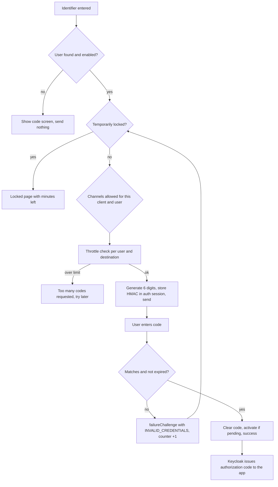
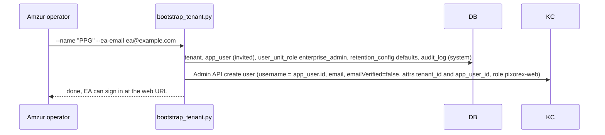
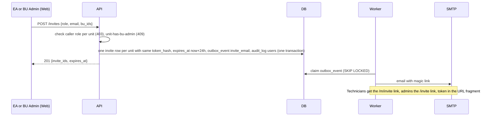
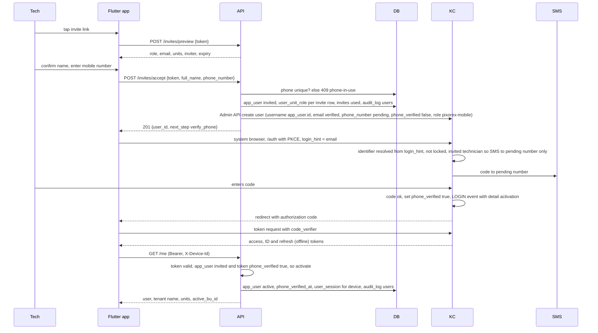
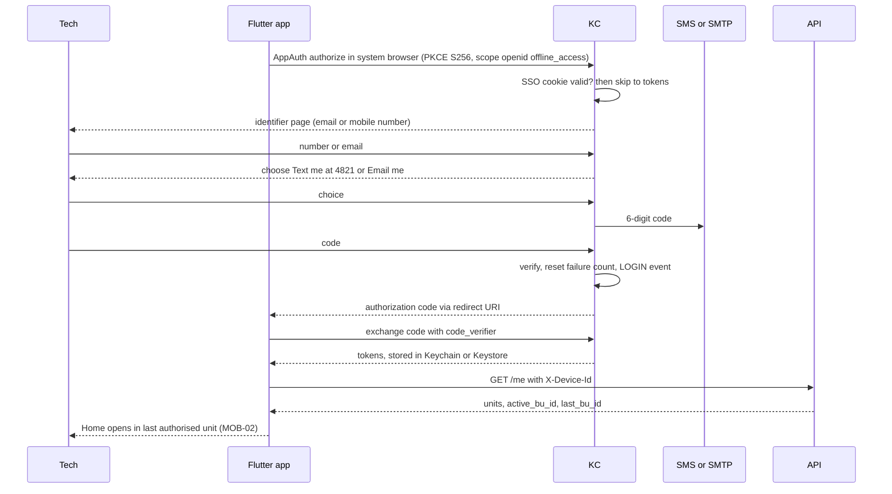
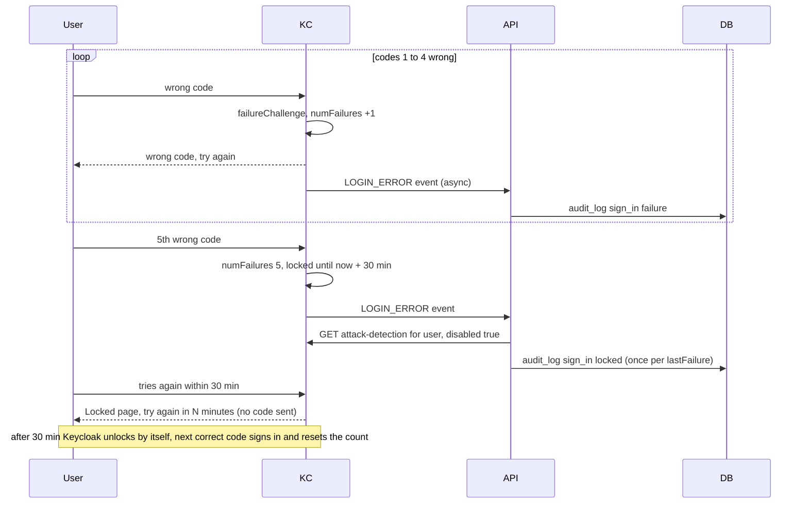
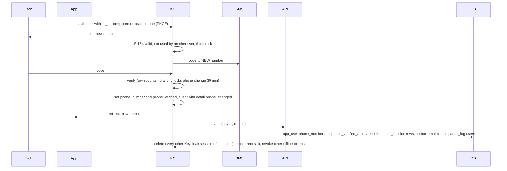
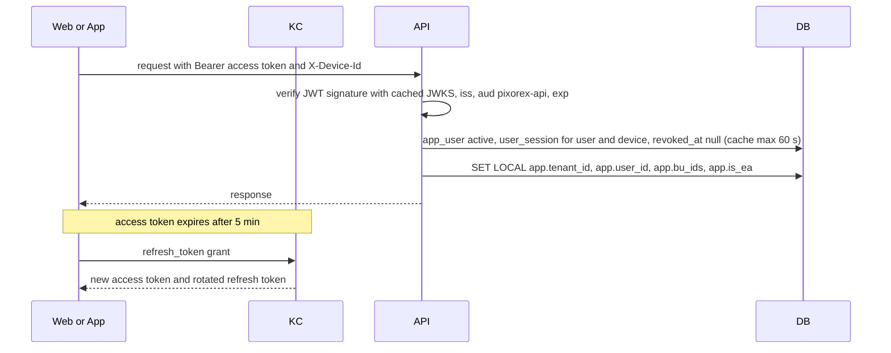
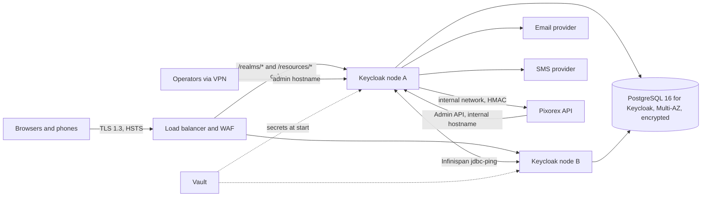

# Keycloak for Pixorex V1 — Design, Flows and Setup

| Field | Value |
|---|---|
| Scope | Identity for the web dashboard (EA, BU Admin) and the Flutter app (Field Technician, delegated reviewer) |
| Bounded context | BC-01 (SPEC-PX-01) — grade **A0**: realm config, authenticators, event listener and client token handling are human-written and architect co-signed |
| Sources | `docs/PRD.md` (FR-1.4–1.8, J02, MOB-01, BU-01), `ARCHITECTURE.md` §4, `specs/SPEC-PX-01.md`, `specs/SPEC-PX-04.md`, `docs/api-contracts.md` Slice 1, `STATE.md` |
| Status | Draft for architect review. Items marked **DECIDE** need a recorded decision in `STATE.md` before they are built |

Contents

1. What Keycloak is
2. What Keycloak handles in Pixorex (and what it does not)
3. Building blocks: realm, clients, user model, claims
4. How one-time codes are generated, sent and verified
5. Lockout, throttling and lock state
6. End-to-end flows (bootstrap, invite, activation, sign-in, refresh, sign-out, removal, phone change)
7. Web and mobile alignment
8. Integrating Keycloak with the API, web and mobile apps
9. Local setup
10. Production setup
11. Decisions needed and recommendations

---

## 1. What Keycloak is

Keycloak is an open-source identity and access management server (a CNCF project). It runs as its own service, stores users and their sessions, and issues standard **OpenID Connect (OIDC) / OAuth 2.0** tokens to applications. Applications do not handle credentials themselves. They send the user to Keycloak, Keycloak authenticates the user, and the application receives signed tokens (JWTs) that it and the backend can verify.

Core concepts used in this document:

| Concept | Meaning |
|---|---|
| Realm | An isolated space holding users, clients, login flows and settings. Pixorex uses one realm, `pixorex` |
| Client | An application that asks Keycloak to sign users in. Pixorex has `pixorex-web` and `pixorex-mobile` (public clients) and `pixorex-api-admin` (service account the API uses to manage users) |
| Authentication flow | An ordered tree of steps ("executions") that Keycloak runs to sign a user in. Each step is an *authenticator*. Pixorex replaces the password step with a one-time-code step |
| SPI | Service Provider Interface: Keycloak's Java plug-in mechanism. Custom authenticators, required actions and event listeners are SPIs packaged as a jar in `/opt/keycloak/providers` |
| Required action | A step a user must complete after authenticating (for example "verify phone"). It can also be started by an app on demand (Application-Initiated Action, `kc_action=`) |
| Protocol mapper | Copies data (for example a user attribute) into token claims |
| Brute-force detection | Built-in counter of failed sign-ins per user with temporary lockout |
| Event listener | SPI that receives sign-in events (LOGIN, LOGIN_ERROR, LOGOUT, …) |
| Admin REST API | HTTP API to create, disable and inspect users and sessions; used by the Pixorex API |

**Version.** The constitution pins Keycloak **24.x**. Keycloak only patches the latest minor release, and the latest is **26.8.1** (13 Oct 2026). 24.x receives no security fixes. This document targets **26.8.x**. Moving the pin is a constitution change that both architects must approve (**DECIDE**, see §11). Where 24.x differs, it is called out.

---

## 2. What Keycloak handles in Pixorex (and what it does not)

The rule from the constitution (§2.7): *sign-in codes, lockout and sessions live in Keycloak; the API has no sign-in, code or lockout endpoints.* The token proves **who** the user is and **which tenant** they belong to. The database (`user_unit_role`) decides **what** they may do.

| Concern | Owner | Notes |
|---|---|---|
| Sign-in UI (identifier, channel choice, code entry, locked state) | **Keycloak** (Pixorex login theme) | Shown in the system browser on mobile and as a redirect on web |
| Generating, sending and verifying one-time codes (SMS and email) | **Keycloak** (custom OTP authenticator SPI) | No passwords anywhere |
| Wrong-code counting across both channels, 5 → 30-minute lock, automatic unlock | **Keycloak** brute-force detection | The custom authenticator must report failures with the `otp` category (§5) |
| Code-request throttling per user and per destination | **Keycloak** (custom SPI) | |
| Activation proof: technician verifies phone, admin verifies email | **Keycloak** (first sign-in of an invited user) | Proposed answer to O-12 (§6.4) |
| Phone change with code to the new number | **Keycloak** (custom required action started from the app) | Proposed answer to O-12 (§6.9) |
| Issuing access, ID and refresh tokens; SSO session; refresh; token revocation | **Keycloak** | |
| `tenant_id`, `app_user_id` claims | **Keycloak** protocol mappers reading user attributes | The frozen model has no Keycloak-ID column (ARCHITECTURE §4.3) |
| Sign-in audit events | **Keycloak** event listener → internal API endpoint → `audit_log` (`sign_in`) | |
| Invitations (token, hash, 24 h expiry, resend, cancel, invite email) | **API** (`invite` table, outbox) | Keycloak never sees an invite |
| Creating, disabling and logging out Keycloak users | **API**, via the Keycloak Admin REST API | At invite accept, tenant bootstrap, removal |
| `app_user.status`, units, roles, `is_primary`, trusted reviewer | **API / PostgreSQL** | Never put roles-per-unit in the token |
| Active unit and per-device session (`user_session`, `X-Device-Id`) | **API / PostgreSQL** | Unit switch needs no new sign-in (O-11) |
| Revocation enforcement within 60 seconds | **API** (`user_session.revoked_at`, cache ≤ 60 s) plus Keycloak session logout | Short access tokens alone cannot guarantee 60 s |
| `audit_log`, notifications, outbox | **API / PostgreSQL** | |

---

## 3. Building blocks: realm, clients, user model, claims

### 3.1 Realm `pixorex`

One realm per deployment. V1 is the dedicated-deployment tier (one customer per deployment), so one realm holds one tenant. The `tenant_id` claim is still emitted so the API never trusts a URL for tenant (ARCHITECTURE §10) and so a shared deployment later needs no token change.

Key realm settings:

| Setting | Value | Why |
|---|---|---|
| User registration | Off | Users only arrive through invites or bootstrap |
| Forgot password, remember me, edit username | Off | No passwords |
| Login with email | On; duplicate emails **off** | Email is unique per tenant; one tenant per realm |
| Verify email (built-in link) | Off | Email is verified by code (§6.4) |
| Brute-force detection | Lockout temporarily, details in §5 | FR-1.5 |
| User profile | Declare `app_user_id`, `tenant_id`, `phone_number`, `phone_verified` as **admin-only** (users can view nothing, edit nothing) | Keycloak 24+ rejects or hides undeclared attributes, and users must never edit their own claims |
| Account console | Disabled (remove `manage-account` from default roles) | Users have nothing to manage in Keycloak |
| Events | Login events on (stored ~7 days), admin events on; listeners `jboss-logging`, `pixorex-audit` | Audit and troubleshooting |
| SMTP | Realm SMTP (Mailpit locally, provider in prod), password via `${vault.smtp_password}` | Email codes are sent by Keycloak itself |
| Access token lifespan | 5 minutes | Limits a stolen token. Revocation within 60 s is still enforced by the API |
| SSO session idle / max | 30 min / 10 h (**DECIDE**) | Applies to the web dashboard |
| Offline session idle / max | 14 days / 30 days (**DECIDE**) | Applies to the mobile app (offline-first, §7) |
| Revoke refresh token | On, max reuse 0 | Refresh-token rotation; a replayed refresh token kills the session |

### 3.2 Clients

| Client | Type | Used by | Flows enabled | Notes |
|---|---|---|---|---|
| `pixorex-web` | Public | React dashboard | Authorization Code + PKCE (S256) only | Exact redirect URIs and web origins, no wildcards. `offline_access` not allowed. Browser flow override → `pixorex-web-browser` |
| `pixorex-mobile` | Public | Flutter app | Authorization Code + PKCE (S256) only | Redirect via claimed HTTPS link or a private-use scheme (`com.pixorex.mobile:/oauth2redirect`). `offline_access` optional scope. Browser flow override → `pixorex-mobile-browser` |
| `pixorex-api-admin` | Confidential, service account only | FastAPI | Client credentials | Roles: `realm-management` → `manage-users`, `view-users`, `query-users` only. Secret in Vault |
| `pixorex-api` | Bearer-only audience | — | None | Exists so both public clients add `aud: pixorex-api` (audience mapper). The API rejects tokens without it |

On every client: direct access grants (password grant) **off**, implicit **off**, device flow **off**, CIBA **off**. This makes REQ-01.01 ("a password grant is refused") true by configuration.

### 3.3 Keycloak user ↔ `app_user`

The API creates every Keycloak user through the Admin API. Keycloak stores no business data beyond what login needs.

| Keycloak field | Value | Set by |
|---|---|---|
| `username` | `app_user.id` (UUID) | API at creation; never shown to users. Gives the API a direct lookup (`GET /users?username={id}&exact=true`) |
| `email`, `emailVerified` | Invite email; `false` for admins until first email code, `true` for technicians after accept (the invite link reached that inbox) | API, then Keycloak |
| `enabled` | `true` while the user has any active unit role; `false` when removed from all units | API |
| attribute `app_user_id` | `app_user.id` | API |
| attribute `tenant_id` | `tenant.id` | API |
| attribute `phone_number` | E.164, technicians only. Pending until verified | API at accept; Keycloak on phone change |
| attribute `phone_verified` | `true` / `false` | Keycloak OTP authenticator / phone-change action |
| realm role `pixorex-web` | Holds an `enterprise_admin` or `bu_admin` role row | API, on every role change |
| realm role `pixorex-mobile` | Holds a `field_technician` role row | API, on every role change |

The two realm roles only decide **which app a person may sign into** (defence in depth for "technicians never get dashboard access"). They are not used for authorization inside the API. `user_unit_role` stays authoritative (CONSTITUTION §3).

Mapping of `app_user.status` to Keycloak state:

| `app_user.status` | Keycloak user | What sign-in does |
|---|---|---|
| no row (invite pending) | does not exist | Unknown identifier: generic "code sent if the account exists" screen, nothing sent |
| `invited` | exists, enabled, `phone_verified=false` (technician) or `emailVerified=false` (admin) | **Activation sign-in**: the only offered channel is the one being verified |
| `active` | enabled, verified | Normal sign-in |
| `removed` | `enabled=false`, sessions logged out, offline tokens revoked | Nothing sent; generic failure (REQ-01.02) |

### 3.4 Token claims

| Claim | Source | Used by |
|---|---|---|
| `sub` | Keycloak user id | Logging correlation only |
| `tenant_id` | attribute mapper | API sets `app.tenant_id` |
| `app_user_id` | attribute mapper | API loads `app_user` |
| `email_verified`, `phone_verified` | built-in / attribute mapper | API activation check (§6.4) |
| `aud` contains `pixorex-api` | audience mapper | API audience check |
| `azp` | `pixorex-web` or `pixorex-mobile` | API can reject a web token on mobile-only paths if needed |
| `sid` | Keycloak session id | API keeps it beside `user_session` so it can log out other devices (§6.9) |

No unit, role or active-unit claim. The active unit lives in `user_session.active_bu_id` (O-11 proposal), so switching units never needs a new token.

---

## 4. How one-time codes are generated, sent and verified

Keycloak has no built-in email or SMS code login. It has TOTP authenticator apps, passkeys and passwords. Pixorex therefore ships a custom SPI jar (`keycloak/spi/`, built into `/opt/keycloak/providers`). Community plugins (for example `arados/keycloak-otp`, `for-keycloak/email-otp-authenticator`) show the pattern. We write our own because lockout reporting, channel rules, activation and audit are Pixorex-specific and the code is A0.

### 4.1 SPI components

| Component | Keycloak interface | Responsibility |
|---|---|---|
| `pixorex-identifier` | `Authenticator` | Asks for email (web) or email or mobile number (mobile). Resolves the user (email, or `phone_number` with `phone_verified=true`). Never reveals whether the account exists |
| `pixorex-lock-check` | `Authenticator` | If brute-force has the user temporarily disabled, shows the **locked** page with minutes remaining (MOB-01 needs this explicitly) and stops |
| `pixorex-channel` | `Authenticator` (configurable: allowed channels) | Decides which channels to offer (rules in §4.2). Skips the screen if only one channel applies |
| `pixorex-otp` | `Authenticator`, factory `getReferenceCategory()` returns `"otp"` | Generates, sends, verifies the code. Reports wrong codes to brute-force detection. Completes activation (§6.4) |
| `pixorex-update-phone` | `RequiredActionProvider` (started with `kc_action`) | Phone change with a code to the new number and its own 5/30 lock (§6.9) |
| `pixorex-sms` | Custom SPI `SmsSender` with providers `amzur` (prod), `mailpit` and `log` (local) | Sends the SMS. Credentials from Keycloak's vault |
| `pixorex-audit` | `EventListenerProvider` | Posts events to the API's internal endpoint (§8.4) |
| `pixorex` theme | FreeMarker login theme | Identifier, channel, code, locked, expired and error pages matching MOB-01 and the admin sign-in screens |

### 4.2 Channel rules

| Situation | Client | Channels offered |
|---|---|---|
| Admin (EA or BU Admin), active or invited | `pixorex-web` | Email only |
| Technician, invited (phone not yet verified) | `pixorex-mobile` | SMS to the pending number only, which activates the account |
| Technician, active | `pixorex-mobile` | SMS or email (user's choice; last choice pre-selected) |
| Person holding both admin and technician roles | either | Follows the client: web → email, mobile → SMS or email |
| Technician on the web dashboard | `pixorex-web` | Denied before any code is sent (no `pixorex-web` role) |

The rule is tied to the **client**, not to a stored "user type". That keeps the PRD wording ("technicians SMS or email, admins email") true even for people with roles in both apps.

### 4.3 Generation

- 6 numeric digits from `java.security.SecureRandom` (10⁶ space; 5 tries per 30 min makes guessing negligible).
- Stored in the **authentication session** (server side, bound to this one browser login attempt), never in the database or logs. Notes: `otp.hash` = HMAC-SHA256(code, random per-session salt), `otp.salt`, `otp.expires_at`, `otp.channel`, `otp.destination_hash`.
- TTL: **5 minutes** (**DECIDE**, SPEC REQ-01.02 TBD).
- A resend creates a new code and overwrites the old one, so only the latest code works. Resend has a 60-second cooldown (retry timer in MOB-01).

### 4.4 Delivery

- **Email:** Keycloak's `EmailTemplateProvider` using realm SMTP, with a Pixorex template. Locally the email lands in Mailpit.
- **SMS:** `pixorex-sms` provider. Message format (supports one-tap autofill in Safari and Chrome on Android through domain-bound codes / WebOTP):

  ```text
  Pixorex sign-in code: 482913. It expires in 5 minutes. Never share it.

  @auth.pixorex.example #482913
  ```

- The code input field uses `autocomplete="one-time-code"` and `inputmode="numeric"`.
- Sending happens inside Keycloak, synchronously. This is the one external effect that does not go through the API outbox. ARCHITECTURE §2 already places the SMS call in the Keycloak authenticator.
- Destinations are masked on screen (`•••• 4821`, `r••••@example.com`).

### 4.5 Verification

1. Recompute HMAC of the entered code and compare in constant time (`MessageDigest.isEqual`).
2. Expired or missing code → treated as a **wrong** code (REQ-01.02) with an explicit "expired" message.
3. Wrong → `context.failureChallenge(AuthenticationFlowError.INVALID_CREDENTIALS, form)`. This is the call that increments brute-force counting. `context.failure()` does not count.
4. Right → remove the code notes (single use), apply activation (§6.4) if needed, `context.success()`. Keycloak resets the failure count on success, so "4 wrong then 1 right" works (REQ-01.03).



---

## 5. Lockout, throttling and lock state

### 5.1 Brute-force configuration (FR-1.5, AT-03)

| Setting (admin console name) | Value | Effect |
|---|---|---|
| Brute force mode | Lockout temporarily | Automatic unlock, no admin approval |
| Max login failures | 5 | The 5th wrong code locks |
| Strategy | Multiple | wait = increment × (failures ÷ 5) |
| Wait increment | 30 min | 5th failure → 30 min |
| Max wait | 30 min | Never longer than 30 min |
| Failure reset time | 30 min | After a lock expires the next mistake starts a fresh count instead of re-locking at once |
| Quick login check / minimum quick login wait | 1000 ms / 60 s (defaults) | Blocks scripted guessing |
| Maximum temporary lockouts | 0 | Never escalate to permanent |
| Maximum secondary authentication failures | **0 (disabled)** | Otherwise 100 cumulative OTP failures lock the account permanently, which contradicts "no one approves an unlock" |

Two Keycloak behaviours the custom code must respect:

- **Category filter.** Keycloak 26 counts failures only for authenticators whose category is `password`, `otp` or `recovery-authn-codes`. `pixorex-otp`'s factory must return `"otp"` from `getReferenceCategory()`, or lockout silently never happens.
- **Same counter for both channels.** SMS and email run through the same authenticator and user, so wrong codes add up across channels, as the PRD requires.

On Keycloak's own pages a locked user just sees "invalid". MOB-01 requires an explicit locked state, so `pixorex-lock-check` uses `BruteForceProtector.isTemporarilyDisabled(...)` and the user's login-failure record to show the minutes left. This tells a person who already knows the identifier that the account is locked. The product requires that screen. Unknown identifiers still get the generic screen.

### 5.2 Code-request throttling (REQ-01.04)

Brute-force detection counts wrong codes, not code *requests*. Without a separate limit, someone could flood a victim's phone with SMS. `pixorex-otp` keeps rolling counters in Keycloak's cluster-replicated single-use-object store (`SingleUseObjectProvider`, entries expire by themselves):

- per user: at most **5 codes per 15 minutes** (**DECIDE**, SPEC TBD)
- per destination (phone or email): the same limit, so one number cannot be targeted through several accounts
- 60-second cooldown between sends

The reverse proxy also rate-limits `/realms/pixorex/login-actions/*` per IP (§10).

### 5.3 Lock state for BU-01 (contract 1.18, O-13 proposal)

The API reads `GET /admin/realms/pixorex/attack-detection/brute-force/users/{keycloakUserId}` → `{numFailures, disabled, lastFailure, lastIPFailure}`. If `disabled` is true, `sign_in_locked_until = lastFailure + 30 min`. Cache for 30 seconds per user so a 25-row list does not make 25 calls on every refresh.

### 5.4 Lock audit row (REQ-01.03)

Keycloak has no distinct "lock started" event, and its failure processing is asynchronous. Recommended approach: on every `LOGIN_ERROR` with `invalid_user_credentials` the API's internal event handler checks the attack-detection endpoint. If `disabled` is true and no `sign_in` audit row exists for that `(user, lastFailure)`, it writes one (actor `system`, action `sign_in_locked`). Using `lastFailure` as the key keeps it to exactly one row per lock.

---

## 6. End-to-end flows

Actors: **EA** (web), **BU Admin** (web), **Tech** (mobile), **Web** (React app), **App** (Flutter), **KC** (Keycloak), **API** (FastAPI), **DB** (PostgreSQL), **Worker** (outbox worker), **SMTP/SMS** providers.

### 6.1 Tenant bootstrap — first Enterprise Admin (P-1 proposal)



The EA's first web sign-in sends an email code. Verifying it sets `emailVerified=true`, which activates the EA (§6.4). If the Keycloak call fails after the DB commit, the script must be safe to rerun (it finds the existing user by username).

### 6.2 Invitation — creation (contracts 1.8–1.11)

Who invites whom: EA → BU Admin, BU Admin → technicians (O-5 still open for EA inviting technicians).



- The raw token exists only in the email. The DB stores `token_hash` (SHA-256).
- The token sits in the URL **fragment** (`#t=`). Browsers never send fragments to servers, so the token stays out of proxy and access logs. The app reads it and sends it in a request **body** (contract 1.6–1.7).
- Keycloak is not involved until accept.
- Resend issues a new token and a new 24-hour window, and the old hash stops matching. Cancel sets `cancelled`.

### 6.3 Invitation — opening the link

| Invitee | Link opens | How |
|---|---|---|
| Technician | Flutter app | Android App Links (`/.well-known/assetlinks.json`) and iOS Universal Links (`apple-app-site-association`) on the app domain, path `/m/invite`. If the app is not installed, a small web page shows store links and keeps the fragment so a "Continue in app" button works after install |
| BU Admin / EA | Web dashboard `/invite` route | Normal SPA route |

Then the app calls `POST /invites/preview {token}`. Expired, used or cancelled links return 409 with `invite-expired`, `invite-used` or `invite-cancelled`. The screen says "ask your admin to resend".

### 6.4 Invitation — accept and activation (technician, mobile)

Proposed answer to O-12: **activation is the user's first Keycloak sign-in, on the channel being verified.** No separate verification endpoint in the API.



Notes:

- **Activation is idempotent and has two paths.** The API activates either on the first authenticated call that carries `phone_verified=true` (or `email_verified=true` for admins) or when the event listener delivers the activation event, whichever comes first. The app never waits on the asynchronous listener. This changes step 2 of ARCHITECTURE §4.4 ("app_user must be active") to "active, or invited with the verification claim" — part of the O-12 decision.
- **Ordering.** The DB transaction commits first, then the Keycloak user is created. If the Keycloak call fails, accept returns an error and a retry with the same token must succeed. The API treats "invite used by this same pending app_user and no Keycloak user yet" as resumable, and the Keycloak create is keyed by `username = app_user.id`, so it is safe to repeat.
- **Multi-unit invites (O-23 proposal):** accepting one link accepts every pending invite for that email in the tenant. `is_primary` = unit of the oldest invite. Keycloak is unaffected.
- **Existing user invited to another unit:** accept adds role rows only. The Keycloak user already exists; the API only adds the `pixorex-mobile` or `pixorex-web` realm role if it is missing.
- Technicians get no `pixorex-web` role, so they can never sign into the dashboard (REQ-01.11).

### 6.5 Invitation — accept and activation (BU Admin or EA, web)

Same as §6.4 with these differences: accept takes `{token, full_name}` (no phone), returns `next_step: verify_email`, the Keycloak user has `emailVerified=false` and role `pixorex-web`, the web flow offers email only, and success sets `emailVerified=true`, which activates the admin.

### 6.6 Regular sign-in — technician (mobile)



### 6.7 Regular sign-in — EA or BU Admin (web)

Same flow, client `pixorex-web`: identifier = email, email code only, tokens held in memory. On page reload the SPA does a silent `prompt=none` check against the Keycloak SSO cookie (works because `auth.` and `app.` share a site). The SPA then calls `GET /me` and builds the EA or BU Admin navigation from the returned roles.

### 6.8 Wrong code, lockout and automatic unlock (AT-03)



BU-01 shows "Sign-in locked · N min left" from §5.3. No unlock button exists in V1.

### 6.9 Phone change (FR-1.8, contracts 1.4–1.5, O-12 proposal)

With O-12 decided as Keycloak, the phone change runs in Keycloak as an application-initiated action. Contracts 1.4–1.5 then become unnecessary or reduce to a notification hook. That is a contract change for the spec owner.



Brute-force detection only covers authentication, not required actions. So `pixorex-update-phone` keeps its own counter (single-use-object store, 30-minute expiry). The number-already-used check happens in Keycloak (attribute search), and the database unique constraint backs it up when the API applies the change. If the API sees a conflict, it raises an alert instead of silently diverging.

### 6.10 Token refresh and every API call



If a refresh fails (session ended, user disabled), the web app returns to sign-in and the mobile app shows MOB-01. **The mobile offline queue is kept** encrypted and is never synced under a different user or unit (AT-02).

### 6.11 Sign-out, removal and unit switch

| Event | API action | Keycloak action |
|---|---|---|
| User signs out on one device (1.3) | `user_session.revoked_at` for that device, audit `sign_in` | Web: RP-initiated logout (`end_session_endpoint` with `id_token_hint`). Mobile: revoke refresh token at `/protocol/openid-connect/revoke`, clear secure storage |
| Removed from one unit, keeps others (1.17, 1.19) | `user_unit_role.removed_at`; requests scoped to that unit get 403 within 60 s (AT-12) | Remove `pixorex-web` / `pixorex-mobile` role only if no role of that kind remains |
| Removed from all units | Revoke every `user_session`, `app_user.status = removed` | `enabled=false`, `POST /users/{id}/logout`, revoke `pixorex-mobile` offline tokens (`DELETE /users/{id}/consents/pixorex-mobile`) |
| Unit switch (1.2) | `user_session.active_bu_id`, `app_user.last_bu_id` | Nothing — no new sign-in |

The 60-second guarantee comes from the API's `user_session` check, not from token expiry. Keycloak logout only stops *new* tokens from being minted.

---

## 7. Web and mobile alignment

Both apps use the same realm, the same OTP authenticator, the same lockout counter, the same claims and the same API pipeline. They differ only where the platform or the PRD requires it:

| Aspect | Web dashboard (`pixorex-web`) | Mobile app (`pixorex-mobile`) |
|---|---|---|
| Users | EA, BU Admin | Field Technician, delegated reviewer, any admin who also holds a technician role |
| Screens | EA/BU Admin sign-in (Keycloak theme), `/invite` | MOB-01 (Keycloak theme in system browser), invite deep link, MOB-02 |
| Library | `oidc-client-ts` (or `keycloak-js`) | `flutter_appauth` (AppAuth-Android / AppAuth-iOS) + `flutter_secure_storage` |
| Browser | Same tab redirect | System browser: Custom Tabs (Android), `ASWebAuthenticationSession` (iOS). Never an embedded WebView (RFC 8252) |
| Redirect | `https://app.example/auth/callback` (exact) | Claimed HTTPS link or `com.pixorex.mobile:/oauth2redirect` |
| Channels | Email | SMS or email; SMS only during activation |
| Gate | `pixorex-web` realm role | `pixorex-mobile` realm role |
| Token storage | Memory only (REQ-01.13) | Keychain / Keystore (hardware-backed) |
| Session length | SSO idle 30 min, max 10 h (**DECIDE**) | `offline_access` refresh token, idle 14 days, max 30 days (**DECIDE**), so a technician working offline for days does not lose the ability to sync |
| Reload / resume | Silent `prompt=none` check | Refresh on resume; if it fails, MOB-01 with the queue kept |
| Logout | RP-initiated logout + `POST /me/sign-out` | Token revocation + `POST /me/sign-out` + clear storage |
| Device id | `X-Device-Id` per browser profile (random, local storage) | `X-Device-Id` generated once per install |
| Theme | Responsive pages from the same `pixorex` theme | Same theme, mobile layout |

Why the session lengths differ. If the realm SSO session were long, a web admin's browser cookie would also live long and skip the code. Keeping the SSO session short (web) and giving mobile an offline token, which Keycloak tracks separately, gives each app the right lifetime without weakening the other.

### 7.1 Authentication flows bound per client

```text
pixorex-web-browser                         (override on pixorex-web)
├── Authenticate                            REQUIRED sub-flow
│   ├── Cookie                              ALTERNATIVE
│   └── Code sign-in                        ALTERNATIVE sub-flow
│       ├── pixorex-identifier              REQUIRED   (email only)
│       ├── Web access gate                 CONDITIONAL sub-flow
│       │   ├── Condition - user role       pixorex-web, negate = true
│       │   └── Deny access                 REQUIRED   ("Use the Pixorex mobile app")
│       ├── pixorex-lock-check              REQUIRED
│       ├── pixorex-channel                 REQUIRED   (config: email)
│       └── pixorex-otp                     REQUIRED
└── Web access gate (again, for SSO-cookie sign-ins)   CONDITIONAL sub-flow

pixorex-mobile-browser                      (override on pixorex-mobile)
  same shape, identifier accepts email or mobile number,
  gate role pixorex-mobile, channel config: sms,email
```

The gate runs before any code is sent, and runs again after the cookie path. A shared phone browser cookie therefore cannot carry a technician into the dashboard.

---

## 8. Integrating Keycloak with the API, web and mobile apps

### 8.1 Repository layout

```text
keycloak/
├── realm/realm-pixorex.json      # realm as code, imported locally; applied by keycloak-config-cli in deployed envs
├── spi/                          # Maven project: authenticators, required action, SMS SPI, event listener
│   └── src/main/java/com/amzur/pixorex/keycloak/...
├── providers/                    # built jar lands here (git-ignored)
├── themes/pixorex/login/         # FreeMarker templates, messages, CSS
└── Dockerfile                    # production image (§10.2)
```

SPEC-PX-01 REQ-01.01 names `keycloak/realm-pixorex.json`, but `docker-compose.yml` mounts `keycloak/realm/`. Use `keycloak/realm/realm-pixorex.json` and fix the spec wording.

### 8.2 Realm-as-code excerpt

Illustrative only. The real file is A0 and is reviewed by an architect.

```json
{
  "realm": "pixorex",
  "enabled": true,
  "registrationAllowed": false,
  "resetPasswordAllowed": false,
  "rememberMe": false,
  "loginWithEmailAllowed": true,
  "duplicateEmailsAllowed": false,
  "bruteForceProtected": true,
  "permanentLockout": false,
  "maxTemporaryLockouts": 0,
  "bruteForceStrategy": "MULTIPLE",
  "failureFactor": 5,
  "waitIncrementSeconds": 1800,
  "maxFailureWaitSeconds": 1800,
  "maxDeltaTimeSeconds": 1800,
  "quickLoginCheckMilliSeconds": 1000,
  "minimumQuickLoginWaitSeconds": 60,
  "accessTokenLifespan": 300,
  "ssoSessionIdleTimeout": 1800,
  "ssoSessionMaxLifespan": 36000,
  "offlineSessionIdleTimeout": 1209600,
  "offlineSessionMaxLifespanEnabled": true,
  "offlineSessionMaxLifespan": 2592000,
  "revokeRefreshToken": true,
  "refreshTokenMaxReuse": 0,
  "eventsEnabled": true,
  "eventsListeners": ["jboss-logging", "pixorex-audit"],
  "adminEventsEnabled": true,
  "loginTheme": "pixorex",
  "smtpServer": {
    "host": "mailpit", "port": "1025", "from": "no-reply@pixorex.local",
    "auth": "false", "ssl": "false", "starttls": "false"
  },
  "roles": { "realm": [ { "name": "pixorex-web" }, { "name": "pixorex-mobile" } ] },
  "clients": [
    {
      "clientId": "pixorex-web",
      "publicClient": true,
      "standardFlowEnabled": true,
      "directAccessGrantsEnabled": false,
      "implicitFlowEnabled": false,
      "redirectUris": ["http://localhost:5173/auth/callback"],
      "webOrigins": ["http://localhost:5173"],
      "attributes": {
        "pkce.code.challenge.method": "S256",
        "post.logout.redirect.uris": "http://localhost:5173/"
      },
      "defaultClientScopes": ["openid", "profile", "email", "pixorex-claims"],
      "optionalClientScopes": []
    },
    {
      "clientId": "pixorex-mobile",
      "publicClient": true,
      "standardFlowEnabled": true,
      "directAccessGrantsEnabled": false,
      "implicitFlowEnabled": false,
      "redirectUris": ["com.pixorex.mobile:/oauth2redirect"],
      "attributes": {
        "pkce.code.challenge.method": "S256",
        "post.logout.redirect.uris": "com.pixorex.mobile:/logout"
      },
      "defaultClientScopes": ["openid", "profile", "email", "pixorex-claims"],
      "optionalClientScopes": ["offline_access"]
    }
  ],
  "clientScopes": [
    {
      "name": "pixorex-claims",
      "protocol": "openid-connect",
      "protocolMappers": [
        { "name": "tenant_id", "protocol": "openid-connect", "protocolMapper": "oidc-usermodel-attribute-mapper",
          "config": { "user.attribute": "tenant_id", "claim.name": "tenant_id", "jsonType.label": "String",
                      "access.token.claim": "true", "id.token.claim": "true", "userinfo.token.claim": "true" } },
        { "name": "app_user_id", "protocol": "openid-connect", "protocolMapper": "oidc-usermodel-attribute-mapper",
          "config": { "user.attribute": "app_user_id", "claim.name": "app_user_id", "jsonType.label": "String",
                      "access.token.claim": "true", "id.token.claim": "true", "userinfo.token.claim": "true" } },
        { "name": "phone_verified", "protocol": "openid-connect", "protocolMapper": "oidc-usermodel-attribute-mapper",
          "config": { "user.attribute": "phone_verified", "claim.name": "phone_verified", "jsonType.label": "boolean",
                      "access.token.claim": "true", "id.token.claim": "false", "userinfo.token.claim": "false" } },
        { "name": "api-audience", "protocol": "openid-connect", "protocolMapper": "oidc-audience-mapper",
          "config": { "included.custom.audience": "pixorex-api", "access.token.claim": "true" } }
      ]
    }
  ]
}
```

Also in the file: the two browser flows (§7.1) with fixed ids so `authenticationFlowBindingOverrides` can reference them; the `pixorex-api-admin` client with its service-account roles; the user-profile declaration with admin-only attributes; required action `pixorex-update-phone` enabled. Leave out of git: client secrets and the SMTP password (Vault references only), and users (the bootstrap and seed scripts create them).

### 8.3 API (FastAPI) side

| Piece | Implementation |
|---|---|
| Token validation | `PyJWT` or `python-jose` against `https://<kc>/realms/pixorex/protocol/openid-connect/certs` (JWKS cached, refetched on unknown `kid`). Check `iss`, `aud=pixorex-api`, `exp`, `azp ∈ {pixorex-web, pixorex-mobile}` |
| Admin client | `httpx` calling the Admin REST API with a client-credentials token for `pixorex-api-admin` (secret from Vault). Wrap it in one module (`app/auth/keycloak_admin.py`) |
| Admin calls used | create user, update attributes and roles, enable/disable, `GET /users?username=`, `POST /users/{id}/logout`, `GET/DELETE /users/{id}/sessions`, `DELETE /users/{id}/consents/pixorex-mobile`, `GET /attack-detection/brute-force/users/{id}` |
| Internal events endpoint | `POST /internal/keycloak-events` — not in the public contract. Reachable only on the internal network. Request signed with an HMAC (shared secret in Vault). Idempotent on Keycloak's event id |
| Event handling | `LOGIN` → audit `sign_in` (user, tenant, client, IP, device id if passed as a login parameter), activation check. `LOGIN_ERROR` → audit failure + lock check (§5.4). `LOGOUT` → audit. Phone-change event → §6.9 |
| `/ready` | Includes a Keycloak check (well-known endpoint reachable) — contract 4.4 |

### 8.4 Event listener reliability (REQ-01.05)

`EventListenerProvider.onEvent` runs inside the sign-in request. The listener must never call the API inline. It hands the event to an after-commit task with a bounded in-memory retry queue and backoff, so sign-in never blocks or fails when the API is down. Because an in-memory queue is lost if Keycloak restarts, the API also runs a **reconciliation job** every few minutes. The job reads `GET /admin/realms/pixorex/events?dateFrom=…` (Keycloak stores events for ~7 days) and inserts any audit rows that are missing, keyed by event id. Together these give at-least-once audit delivery.

### 8.5 Web (React + Vite)

- Use `oidc-client-ts` (`UserManager` with `response_type=code`, PKCE default, `userStore` in memory, `automaticSilentRenew` using the refresh token). `keycloak-js` 26.2.x is a valid alternative.
- Callback route `/auth/callback`. Silent-check page for `prompt=none` on reload.
- Attach `Authorization` and `X-Device-Id` in the typed API client. On 401, try one refresh, then send the user to sign-in.
- Sign-out: `POST /me/sign-out`, then `signoutRedirect({ id_token_hint })`.
- Invite route `/invite` reads `location.hash`, clears it from history (`history.replaceState`), and calls preview and accept.

### 8.6 Mobile (Flutter)

```dart
final result = await appAuth.authorizeAndExchangeCode(
  AuthorizationTokenRequest(
    'pixorex-mobile',
    'com.pixorex.mobile:/oauth2redirect',
    issuer: 'https://auth.example.com/realms/pixorex',
    scopes: ['openid', 'profile', 'email', 'offline_access'],
    loginHint: emailFromInvite,          // activation path
    additionalParameters: {'ui_locales': 'en'},
  ),
);
await secureStorage.write(key: 'refresh_token', value: result.refreshToken);
```

- Android: `manifestPlaceholders['appAuthRedirectScheme'] = 'com.pixorex.mobile'`. iOS: register the URL scheme. If you prefer claimed HTTPS redirects, use the same associated domain as the invite links.
- Phone change: `authorizeAndExchangeCode` with `additionalParameters: {'kc_action': 'pixorex-update-phone'}`.
- Certificate pinning covers the app's own HTTP client (API calls). The authorization page runs in the system browser and the AppAuth token exchange uses the platform HTTP stack, so neither is pinned. Decide whether to pin the token endpoint with a custom AppAuth connection builder (**DECIDE**, SPEC-PX-09).
- Local development over HTTP needs `allowInsecureConnections: true` in debug builds only, plus an Android network-security config and an iOS ATS exception scoped to the dev host.

---

## 9. Local setup

Synthetic data only (CONSTITUTION §2.11).

### 9.1 Prerequisites

Docker Desktop, JDK 21 and Maven 3.9 (to build the SPI jar), Node 22 (web), Flutter 3.x (mobile).

### 9.2 Compose changes (proposed, PX-10-T01 / PX-01-T01)

The current `docker-compose.yml` runs `keycloak:24.0` with `KEYCLOAK_ADMIN`. For 26.8:

```yaml
  keycloak:
    image: quay.io/keycloak/keycloak:26.8
    command: ["start-dev", "--import-realm", "--spi-events-listener-jboss-logging-success-level=info"]
    environment:
      KC_DB: postgres
      KC_DB_URL: jdbc:postgresql://keycloak-db:5432/keycloak
      KC_DB_USERNAME: keycloak
      KC_DB_PASSWORD: ${KC_DB_PASSWORD:-local-only}
      KC_BOOTSTRAP_ADMIN_USERNAME: ${KC_ADMIN_USER:-admin}         # replaces KEYCLOAK_ADMIN in 26.x
      KC_BOOTSTRAP_ADMIN_PASSWORD: ${KC_ADMIN_PASSWORD:-local-only}
      KC_HEALTH_ENABLED: "true"
      KC_HOSTNAME: ${KC_HOSTNAME:-http://localhost:8080}           # set to http://<laptop-LAN-IP>:8080 for phone testing
      PIXOREX_SMS_PROVIDER: mailpit                                 # local-only: SMS delivered to the Mailpit inbox
    ports: ["8080:8080", "9000:9000"]                               # 9000 = management (health, metrics) since 25.x
    volumes:
      - ./keycloak/realm:/opt/keycloak/data/import:ro
      - ./keycloak/themes/pixorex:/opt/keycloak/themes/pixorex:ro
      - ./keycloak/providers:/opt/keycloak/providers:ro
    depends_on:
      keycloak-db: { condition: service_healthy }
      mailpit: { condition: service_started }
```

These are local-only placeholders, like the rest of the file. Note that the existing compose maps the theme volume to `themes/pixorex`, while the folder in the repo is `keycloak/themes/`. Keep the theme in `keycloak/themes/pixorex/`.

### 9.3 Steps

1. Build the SPI: `mvn -f keycloak/spi/pom.xml package` and copy the jar to `keycloak/providers/` (add a `make kc-build` target).
2. Start the stack: `make up`, then `make ps` until everything is healthy. Keycloak health is at `http://localhost:9000/health/ready`.
3. The realm imports automatically from `keycloak/realm/realm-pixorex.json`. `--import-realm` **skips an existing realm**, so after changing the JSON run `make reset` (wipes local data) or apply it with keycloak-config-cli (§10.4).
4. Admin console: `http://localhost:8080/admin` (local admin credentials). Check: realm `pixorex`, both clients, both browser flows bound, brute-force settings, `pixorex-audit` listener enabled.
5. Create users: `python api/scripts/bootstrap_tenant.py --name "Demo Tenant" --ea-email ea@demo.local`, then `make seed` for the synthetic dataset (REQ-04.06).
6. Read codes: emails and "SMS" both appear in Mailpit at `http://localhost:8025` (SMS arrive as mail to `sms+<number>@pixorex.local`).
7. Web: `npm run dev` in `web/` on `http://localhost:5173` (matches the redirect URI).
8. Mobile on a real phone or emulator:
   - The issuer in tokens must equal what the API validates. Set `KC_HOSTNAME=http://<laptop-LAN-IP>:8080` and use that same URL in the API config and the app. Using `localhost` on the laptop and `10.0.2.2` on an Android emulator gives two different issuers, and validation fails.
   - Debug builds allow HTTP to that host only (§8.6).
9. Test lockout (AT-03 demo): enter 5 wrong codes, see the locked page and the audit row, wait 30 minutes or temporarily lower the wait locally, then sign in.
10. Export changes made in the console back to code with `kc.sh export --realm pixorex --users skip` (inside the container) and diff the result. Never commit secrets.

### 9.4 CI

The `keycloak` workflow (SPEC-PX-10 REQ-10.04) builds the SPI, runs unit tests on the authenticators, starts Keycloak with the realm in Compose, and runs a smoke test:

- the realm and both clients exist
- a password grant is refused
- a full code sign-in through the Mailpit API returns a token with `tenant_id` and `app_user_id`
- 5 wrong codes lock the user

---

## 10. Production setup

Real client data only on US infrastructure (US VPS, then AWS us-east-1). India E2E uses the same setup with synthetic data. Keycloak holds PII (names, emails, phone numbers), so its database and backups are covered by the US residency rule (AT-18).

### 10.1 Topology



- Two or more Keycloak nodes in separate availability zones. Keycloak 26 persists user sessions in the database by default, so a node restart does not sign people out.
- A **separate** PostgreSQL database for Keycloak (not the Pixorex DB). It is part of the backup and WAL/RPO design (P-13).
- Public hostname `auth.<domain>`. The **admin console and Admin API are not public**: set `KC_HOSTNAME_ADMIN` to an internal hostname and have the load balancer forward only `/realms/` and `/resources/`.
- Management port 9000 (health, metrics) is internal only.
- Sea Stock (ARCHITECTURE §13) plans a shared Keycloak container with a separate realm. That means both teams' SPI jars and upgrade schedules share one runtime. Agree on joint ownership of the image, or run separate containers (recommended).

### 10.2 Image

```dockerfile
FROM maven:3.9-eclipse-temurin-21 AS spi
WORKDIR /src
COPY keycloak/spi .
RUN mvn -q -B package -DskipTests=false

FROM quay.io/keycloak/keycloak:26.8 AS builder
ENV KC_DB=postgres KC_HEALTH_ENABLED=true KC_METRICS_ENABLED=true KC_CACHE=ispn
COPY --from=spi /src/target/pixorex-keycloak-spi.jar /opt/keycloak/providers/
COPY keycloak/themes/pixorex /opt/keycloak/themes/pixorex
RUN /opt/keycloak/bin/kc.sh build

FROM quay.io/keycloak/keycloak:26.8
COPY --from=builder /opt/keycloak/ /opt/keycloak/
ENTRYPOINT ["/opt/keycloak/bin/kc.sh"]
CMD ["start", "--optimized"]
```

The image is scanned by Trivy in CI (REQ-10.05). Pin the exact patch tag and digest.

### 10.3 Runtime configuration

| Option | Value |
|---|---|
| `hostname` | `https://auth.<domain>` |
| `hostname-admin` | `https://kc-admin.<internal-domain>` |
| `proxy-headers` | `xforwarded` (only from the load balancer) |
| `http-enabled` | `false` unless TLS terminates at the LB with a private re-encrypted hop |
| `db-url`, `db-username`, `db-password` | From Vault |
| `vault` | `file` with `vault-dir=/run/secrets/kc` (tmpfs). Realm values such as `${vault.smtp_password}` and SPI secrets (SMS key, event HMAC secret through `session.vault()`) are read from there |
| `log` | `console`, JSON format; no codes, tokens or full phone numbers in logs |
| `features` | Defaults. Disable anything unused |

**Secrets (CONSTITUTION §2.10).** Keycloak has no native HashiCorp Vault provider; it reads secrets from a files-based vault or a keystore. Run a Vault Agent sidecar that authenticates with AppRole and renders the secrets into a memory-backed volume (`/run/secrets/kc`) at container start. That volume holds the DB password, SMTP password, SMS credentials, the event-listener HMAC secret and the `pixorex-api-admin` client secret. Architects should confirm that "rendered by Vault Agent into tmpfs at start" meets "loaded from Vault, never config files" (**DECIDE**).

### 10.4 Realm configuration in deployed environments

Do not rely on `--import-realm` in production (it never updates an existing realm). Use **keycloak-config-cli** (adorsys) as a pipeline step after each Keycloak deploy. It applies `realm-pixorex.json` idempotently and substitutes per-environment values: redirect URIs, web origins, SMTP host, hostnames. Changes go through PRs to `keycloak/` (CODEOWNERS: architects).

### 10.5 Hardening checklist

- [ ] Brute-force settings exactly as §5.1; secondary-auth lockout 0
- [ ] PKCE S256 required on both public clients; password, implicit and device grants off
- [ ] Exact redirect URIs and web origins per environment, no wildcards
- [ ] Refresh-token rotation on; access tokens 5 min
- [ ] User registration, forgot password, account console off
- [ ] Admin console reachable only on the internal hostname via VPN; admin users use strong credentials and MFA (the built-in OTP or passkey for the `master` realm)
- [ ] `master` realm used only for Keycloak operators; the bootstrap admin account is replaced by named accounts after first start
- [ ] Rate limiting on `/realms/pixorex/login-actions/*` and `/protocol/openid-connect/token` per IP at the LB/WAF
- [ ] Security headers in the realm: CSP `frame-ancestors` limited to the web app origin (for the silent check), `X-Frame-Options`, HSTS from the LB
- [ ] Login and admin events forwarded to the log platform; alerts on lockout spikes and SMS cost spikes
- [ ] Keycloak DB encrypted at rest (AES-256), daily snapshots plus WAL archiving per P-13, restore tested with the monthly drill
- [ ] Upgrade policy: follow each 26.x minor within weeks (only the latest is patched); rehearse on India E2E first; 26.8 is the last 26.x and gets about 6 months of fixes after 27.0 ships in 2027

### 10.6 Email and SMS providers in production

- **Email:** SES or SendGrid (still open). Configure SPF, DKIM and DMARC for the sending domain so codes are not filtered as spam. Keycloak sends sign-in codes directly; the API outbox sends invite emails. Both should use the same provider and sender domain.
- **SMS (P-3):** STATE.md mentions DLT registration. DLT is India's sender registration, so it only matters for India E2E testing. US recipients (production) need **A2P 10DLC brand and campaign registration** or a verified toll-free number with the chosen provider. Unregistered traffic is filtered by US carriers. Plan for this lead time, and keep SMS credentials in Vault and the provider in a US region.

---

## 11. Decisions needed and recommendations

| Ref | Decision | Recommendation in this document | Needed by |
|---|---|---|---|
| — | Keycloak version (constitution pins 24.x) | Move to **26.8.x**. 24.x gets no security patches, and the lockout-category behaviour in §5.1 is documented for 26 | Before PX-01-T01 merges |
| O-12 | Who sends and checks activation and phone-change codes | Keycloak: activation = first sign-in on the channel being verified (§6.4–6.5); phone change = `kc_action` required action (§6.9). API activates on the verification claim or listener event. Contracts 1.4–1.5 change | S2 (blocks PX-01-T08 activation, PX-01-T09) |
| O-13 | Lock state in BU-01 | Admin API attack-detection read, cached 30 s (§5.3) | S2 |
| O-23 | Multi-unit activation | Accept all pending invites for the email; primary = oldest invite (no Keycloak impact) | S2 |
| O-11 | Active unit location | Keep `user_session.active_bu_id`; no unit claim in tokens (§3.4) | S2 |
| P-1 | Tenant + first EA | Operator CLI creating the Keycloak user as in §6.1 | S2 |
| P-3 | SMS provider | Existing Amzur account for India E2E; US production needs 10DLC or toll-free verification (§10.6) | S2 for local/E2E, before US env |
| P-4 | Admin MFA | V1 email code only. Cheapest later upgrade: add a passkey (WebAuthn, built into Keycloak) as a second step for `pixorex-web` | Before release |
| TBD | Code TTL, resend cooldown, request limit | 5 min, 60 s, 5 per 15 min per user and per destination | S2 |
| TBD | Session lengths | Web SSO idle 30 min / max 10 h; mobile offline idle 14 days / max 30 days | S2 |
| TBD | Secrets rendering | Vault Agent → tmpfs files vault (§10.3) | Before India E2E |
| TBD | Token-endpoint pinning on mobile | Decide in SPEC-PX-09 | S3 |
| — | Sea Stock shared Keycloak | Separate containers, or a written joint-ownership agreement for the shared image | Before India E2E |
| — | Spec path fix | `keycloak/realm/realm-pixorex.json` (§8.1) | With PX-01-T01 |

Suggested build order inside S2, mapped to `STATE.md` tasks:

1. **PX-01-T01:** realm JSON, clients, claims, flows bound, brute-force settings.
2. **PX-01-T02 / T03:** `pixorex-identifier`, `pixorex-lock-check`, `pixorex-channel`, `pixorex-otp` (email first, then SMS via the `mailpit` SMS provider, then the real provider) plus throttling.
3. **PX-01-T04:** `pixorex-audit` listener plus the API reconciliation job.
4. **PX-01-T05:** API middleware with activation-on-claim.
5. **PX-01-T08:** accept creates the Keycloak user.
6. **PX-01-T12 / T15:** web and mobile sign-in.
7. **PX-01-T10:** theme.
8. **PX-01-T09** (phone change) once O-12 is recorded.
