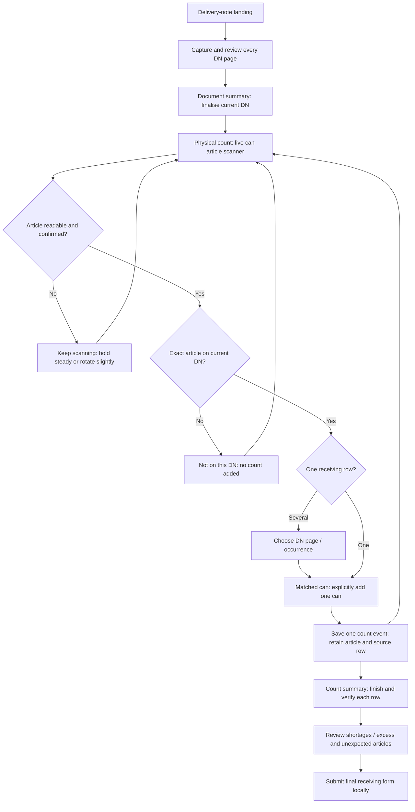

# PPG Sea Stock — DN-scoped can counting

Updated 5 October 2026. This is the revised receiving workflow and screen specification for the existing Pixorex delivery-note feature.

## Requirement and scope

After the operator completes and finalises the delivery-note capture, scan each physical paint can, extract its printed article number, and validate that exact string against the reviewed, quantity-bearing articles captured for the **current DN**. Only an accepted, matched can changes the physical receiving count.

The supplied `PPG_SeaStock_Cylindrical_Article_Scanner_Implementation_Test_Context.md` provides scanner constraints: preserve leading zeros, tolerate usable rotated/curved views, confirm across multiple frames, reject numeric distractors, and keep uncertain scans unresolved. Its suggested implementation sequence, physical benchmark, and exit report are engineering guidance for a scanner spike. They are not evidence that those capabilities or physical tests already exist.

This refinement concerns receiving against an existing DN. Earlier receipt/issue and stocktake briefs remain separate proposals; Issue mode, a new stocktake, stock posting, and a global inventory dashboard are not part of this receiving flow. A local final form means the count was saved locally.

## Revised workflow

Document finalisation establishes an expected article list; it neither verifies physical stock nor adds the DN quantity to the count. Start every untouched physical count at zero, displayed as **Not started** until the operator scans or explicitly records zero received.

## Landing and summary pages

| Screen | Information and actions |
|---|---|
| Delivery-note landing | **New delivery note**, saved DN cards, document stage, accepted count / expected PC, completed receiving rows, last saved time. Resume the selected DN. Show **Review document**, **Start can count**, **Resume can count**, or **View saved form** according to state. |
| Document capture / page checklist | Preserve existing page capture, identity checks, printed article/quantity corrections, coverage confirmation, and optional printed Piece reconciliation. Label this **1. Document**. All declared pages and issues must be resolved before finalisation. |
| Document summary | Current DN, reviewed pages / declared pages, quantity-bearing row count, unique article count, expected PC, and article/product/printed quantity/source page list. Set headings remain contextual and cannot be count targets. Primary action: **Finalise DN and start can count**. |
| Physical-count landing | Persistent **DN number** and **2. Physical count**, document finalised badge, accepted cans / expected PC, rows awaiting verification, and **Scan next can**. Search and filters remain secondary. Expected quantity and accepted count appear separately on every row. |
| Live can scanner | Current DN remains in the header. Read only the article field. Searching → Candidate found → Verifying → Matched. Show the exact article, DN product context, source page, expected quantity, and saved count. Primary action after matching: **Add this can (+1)**. |
| Count summary | DN expected PC; saved running count; completed rows / total receiving rows; scan-confirmed units; manually recorded units; unresolved unexpected-article events; per-row expected, counted, and variance with pending/verified status. Partial receipt remains progress until a row is finished. |
| Final receiving summary | **3. Final review**, current DN and document revision, source checks, verified physical total, full receiving-row list, shortages/excess with reasons, unexpected-scan dispositions, and count-source breakdown. Submit stays disabled while any required check is pending. |
| Local confirmation | **Receiving form saved on this device**, DN, submission time/ID, immutable row counts, variances/reasons, count-source evidence, and resolved unexpected-scan history. Do not imply that inventory or an ERP balance was updated. |

## Match and count rules

1. Build the receiving whitelist from finalised, reviewed, **quantity-bearing rows in the current session**. Keep each original `occurrence_id`, page/capture ID, article string, quantity, and unit. Do not use all open DNs or a global master as the receiving whitelist.
2. Keep article numbers as strings. `121186` and `00121186` are different. No zero-padding, integer conversion, fuzzy match, or barcode-to-article inference. Safely joining OCR fragments needs local geometry and sufficient visual evidence, as specified in the attachment.
3. Extraction certainty and delivery eligibility are separate checks. An exact master match can support identity, but an article is eligible for this receipt only if it exactly matches the current DN. A master or sample fixture never adds an article to the DN.
4. If one article matches several receiving occurrences, show the page, row context, expected quantity, unit, and current count for each; require a deliberate target choice. Preserve all occurrences and allocate each accepted can once. Do not duplicate a +1 across matching rows or silently collapse source rows.
5. Multi-frame verification identifies one can article. It does not count cans. A deliberate **Add this can (+1)** creates one event, pauses acceptance, and asks the operator to move the counted can aside and choose **Scan next can**. Two different cans with the same article are legitimate additions; article equality cannot identify an individual can.
6. Retain existing quantity tools as an explicitly labelled **Manual count / correction** path. Require an exact current-DN article and deliberate source-row choice; label the evidence manual. Manual entry is not OCR-verified. Require a reason for unreadable-label entry or a count correction. Zero received is a valid deliberate outcome.
7. One can equals one PC only for a compatible receiving row. Set headers, litres, kits, and pack/component conversions cannot be inferred. Product/component metadata is optional unless required to disambiguate the target.
8. Save each accepted event and its count delta atomically on the device with an idempotent event ID, session ID, DN/document revision, article, occurrence, method, timestamp, and evidence. Resume after restart without losing totals. Repeated frames, a double tap, or a retry of the same event must not create another unit.
9. **Finish count** marks a row physically verified, requiring a reason for shortage or excess. Reaching expected quantity alone does not finish it. **Reopen count** retains the existing count, removes its verification, and requires another finish.

## Scanner states and recovery

| State | Operator message | Count action |
|---|---|---|
| Searching | Find the printed Article no. field. | Disabled. |
| Candidate found / Verifying | Reading article… hold steady. | Disabled until visual confirmation and DN match. |
| Matched | Article matches DN [number]. | Enable Add this can after target/unit checks. |
| Not on this DN | Article [exact string] is not on DN [number]. | No addition. Rescan, set can aside, or review the selected DN. |
| Multiple matching rows | Choose the receiving row for this can. | Disabled until the operator selects one occurrence. |
| Blur | Hold the camera steady. | No addition; continue scanning. |
| Glare | Tilt the camera or can slightly. | No addition; continue scanning. |
| Not visible / clipped digits | Rotate the can slightly to show Article no. | No guessing; continue scanning. |
| Conflicting candidates | Article is not confirmed. Keep scanning. | No majority guess or fuzzy substitution. |
| Accepted | One can saved; show the updated row total. | Add disabled. Move can aside → Scan next can. |

An unreadable observation is a scanner retry state, not an unexpected product. A readable but out-of-DN article is an unexpected-scan event with zero count delta. The operator can mark the can **Set aside / wrong delivery**, with a reason, or correct the document through source review. Resolved events remain visible in the final history.

## Finalisation, corrections, and submission

The reviewed document revision is the basis of each match. If DN identity, article, expected quantity, page coverage, or unit changes, invalidate finalisation and pause new scan additions until the source is reviewed and re-finalised. Preserve physical counts and events. Reconcile an existing count explicitly if its article identity changed; quantity-only corrections require a count recheck. Never silently reassign earlier can events.

DN selection resets camera candidates and target selection. Each DN keeps its own totals and scan history. Submitted local snapshots stay immutable. Do not reinterpret old manual/defaulted counts as scan-confirmed evidence.

Submission requires finalised source data, no unresolved row allocation or article reconciliation, every quantity-bearing row physically verified (including explicit zero), variance reasons, and disposition of unexpected-scan events. Finishing or submitting saves the physical count; it does not add the expected DN quantity again.

## Data used in the wireframes

The two existing golden DN fixtures provide the actual article/quantity/page examples: DN `5319364114` has **4 pages, 7 receiving rows, 7 unique articles, 62 PC**; DN `5319358250` has **6 pages, 14 receiving rows, 13 unique articles, 100 PC**. Article `475210` repeats on pages 3 and 4 of the second DN, so it demonstrates explicit occurrence selection.

The attachment's labels include `00464138`, `00240476`, `00220294`, `00121186`, `121186`, `30082418`, and `30013603`. These are not the receiving articles in the two golden DN fixtures. They must show **Not on this DN** in those sessions unless the business later supplies a reviewed, approved mapping. The wireframe includes a separately labelled **Illustrative label-test DN** to demonstrate leading-zero success; it is not a transcription of either source PDF.

The clickable wireframe simulates camera observations and local count events. It demonstrates UI and validation decisions; it is not a live OCR engine or a physical-cylinder benchmark.

Android build 36 (1.0.5) adds a real **Scan can article number** button and scanner icon to the receiving list, plus **Scan this article** on each editable row. It uses bundled on-device ML Kit with live camera frames, three-frame confirmation, exact current-DN matching, explicit occurrence allocation, and deliberate +1 acceptance. Counts and scan audit events save together in the existing SQLite transaction; retrying the same event does not add another can. Untouched DN defaults start at one on the first accepted scan. Finishing, variance reasons, and source-correction safeguards continue to use the existing receiving controls.

The runtime uses the existing completed-DN-source-review gate. A separate durable document-finalisation record, the proposed unexpected-article disposition ledger, and the proposed scanned/manual breakdown in final snapshots remain extensions. The scanner has conservative motion/exposure, OCR-confidence, and clipping checks; real cylindrical-can accuracy and operating angles have not been measured on a connected device.

The wireframe was checked in an isolated browser: **47 interaction checks passed**, including exact DN scoping, six/eight-digit string identity, deliberate one-can acceptance, repeated-frame/double-tap protection, duplicate-row allocation, uncertainty rejection, correction review, and local submission locking. The five screens fit at **320 px and 736 px** in the checked states, with no browser runtime errors. These are UI checks, not OCR accuracy measurements. The machine-readable result is in `output/qa/seastock-wireframe-checks.json`.

## Review checks

| Check | Expected result |
|---|---|
| DN captured/finalised, before first can | Expected quantity visible; accepted physical count zero. |
| Same article in several OCR frames | One candidate; no count until Add this can. |
| Matching article accepted, then double tap | Exactly one unit, then acceptance paused. |
| Valid article found in another DN only | Not on current DN; both DN counts unchanged. |
| `121186` versus `00121186` | Exact strings stay distinct; no zero stripping or padding. |
| Article `475210` in the second DN | Choose page 3 or page 4; increment only that occurrence. |
| Batch/EAN/UN/date-only or clipped article | No verified article or count. |
| Master match with no current-DN match | Unexpected event, zero count delta. |
| Switch DN and return | Session totals preserved; old camera candidate cleared. |
| Finish a short/excess row | Reason required; pending count is not presented as a completed variance. |
| Correct source after counting | Preserve counts; pause scanning and invalidate required reviews. |
| Final review / local submission | Block pending checks; save one immutable form; show local save clearly. |

Real-cylinder validation across rotation, curvature, lighting, distance, motion, and partial visibility remains required before production scanner acceptance. The attachment's zero-false-accept target is a test goal, not a measured result.
